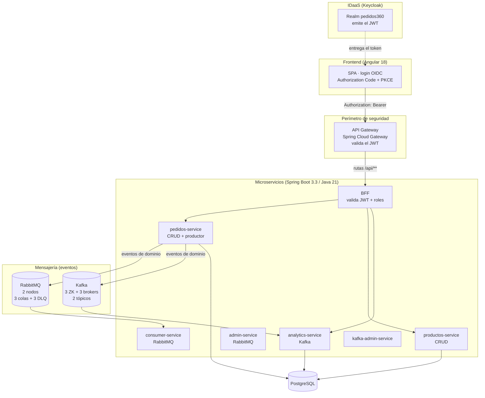
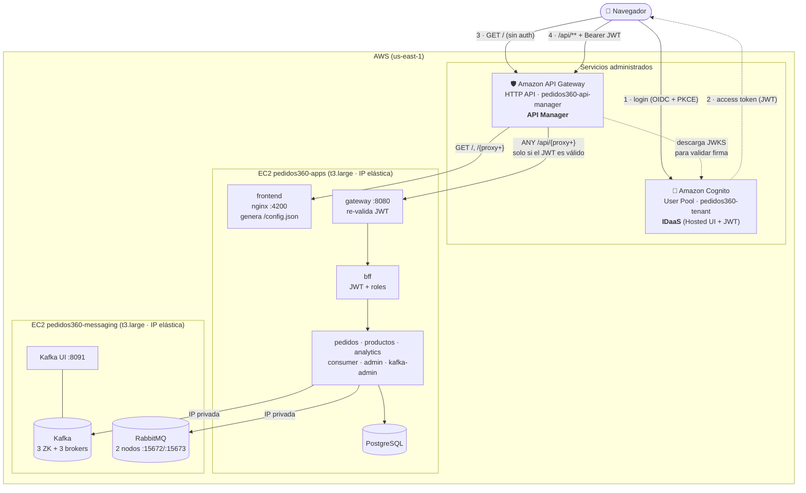

# Cloud-Native — Pedidos360

Proyecto **Pedidos360** — arquitectura **Cloud Native** (Angular + Spring Boot microservicios + RabbitMQ + Apache Kafka + IDaaS).

Se ejecuta en **dos modos** con el mismo código:

| Modo | IDaaS | API Manager | Cómo se levanta |
|------|-------|-------------|-----------------|
| 💻 **Local** | Keycloak (contenedor) | Spring Cloud Gateway | `docker compose` en `infra/apps` |
| ☁️ **Nube (AWS)** | **Amazon Cognito** | **Amazon API Gateway** + Spring Cloud Gateway | `bash infra/aws/deploy.sh` (un comando) |

> 🚀 **¿Primera vez o sesión nueva?** Lee [`docs/ESTADO_Y_CONTEXTO.md`](docs/ESTADO_Y_CONTEXTO.md).
> 🎓 **¿Estudiando para la presentación?** Lee [`docs/GUIA_DE_ESTUDIO_EP6.md`](docs/GUIA_DE_ESTUDIO_EP6.md).

---

## 🧭 Vista general de la arquitectura



### Flujo de una petición (de izq. a der.)

1. **Login** → el SPA autentica contra Keycloak (OAuth 2.0 / OIDC, *Authorization Code + PKCE*) y obtiene un **JWT**.
2. **Llamada a la API** → el SPA envía el JWT en `Authorization: Bearer` a través del **API Gateway**.
3. **API Gateway** → valida firma / issuer / audience / expiración. Token inválido → **401/403**; válido → reenvía al **BFF**.
4. **BFF** → re-valida el JWT (defensa en profundidad), extrae los roles y enruta al microservicio correspondiente.
5. **Eventos** → `pedidos-service` publica eventos de dominio **a la vez** en RabbitMQ (transaccional) y Kafka (streaming/analítica).

---

## ☁️ Arquitectura en la nube (AWS)

En la nube se reemplazan dos piezas por **servicios administrados** de AWS y la plataforma se
reparte en **dos EC2** (el Learner Lab limita a `t3.large`, 8 GB cada una):



**Cómo fluye una petición en la nube**

1. El usuario abre la URL del **API Gateway**; la ruta pública `GET /` entrega el frontend.
2. El frontend lee `/config.json` (issuer y client id de Cognito) y redirige al **Hosted UI de Cognito**.
3. Tras el login, Cognito devuelve un `code` que el SPA canjea (PKCE) por un **access token JWT**
   con el grupo del usuario en `cognito:groups`.
4. Cada llamada `/api/**` lleva `Authorization: Bearer <JWT>`. El **JWT authorizer** del API Gateway
   valida firma, issuer, audiencia y expiración: si falla responde **401** sin tocar el backend.
5. Si es válido, reenvía a la EC2 `apps` → Spring Gateway → BFF (validan otra vez y aplican roles)
   → microservicios → RabbitMQ / Kafka en la EC2 `messaging` por IP privada.

**Decisiones clave**

| Decisión | Por qué |
|----------|---------|
| API Gateway + Cognito administrados | Cumplen "API Manager" e "IDaaS" sin operar servidores propios |
| Doble validación del JWT (API GW + Spring) | Defensa en profundidad: si alguien llega directo a la EC2 igual es rechazado |
| 2 EC2 con IP elástica | Límite de tamaño del lab; las IP fijas mantienen válidas las integraciones del API Gateway entre sesiones |
| Kafka/RabbitMQ por IP privada | Tráfico interno de la VPC, sin exponer brokers a Internet |
| Config OIDC en tiempo de ejecución (`/config.json`) | La misma imagen del frontend sirve para cualquier cuenta: no hay IDs de AWS compilados |
| Backend compatible Keycloak/Cognito | Audiencia por `aud` **o** `client_id`; roles desde `realm_access.roles` **o** `cognito:groups` |

**Despliegue con un comando** (idempotente: crea lo que falta y reutiliza lo que existe):

```bash
bash infra/aws/deploy.sh               # cuenta nueva o cambios de código
SKIP_CODE=1 bash infra/aws/deploy.sh   # misma cuenta, sesión nueva del lab
bash infra/aws/destroy.sh              # borrar todo
```

Detalle de recursos y guion de demo: [`docs/DESPLIEGUE_AWS.md`](docs/DESPLIEGUE_AWS.md).

---

## 🧩 Componentes (monorepo)

| Componente | Tecnología | Puerto | Descripción |
|-----------|-----------|--------|-------------|
| `pedidos360-frontend/` | Angular 18 (standalone, Keycloak) | 4200 | SPA con login OIDC (Authorization Code + PKCE) |
| `pedidos360-bff/` | Spring Boot 3.3 (Java 21) | 8080 | Backend-For-Frontend: valida JWT y enruta a los servicios |
| `pedidos360-pedidos-service/` | Spring Boot 3.3 (Java 21) | 8081 | CRUD de pedidos + **productor** de eventos RabbitMQ **y** Kafka |
| `pedidos360-productos-service/` | Spring Boot 3.3 (Java 21) | 8082 | CRUD de productos |
| `pedidos360-consumer-service/` | Spring Boot 3.3 (Java 21) | 8083 | **Consumidores** RabbitMQ (notificaciones, tickets, documentos) |
| `pedidos360-admin-service/` | Spring Boot 3.3 (Java 21) | 8084 | **Administrador** RabbitMQ (REST para colas/exchanges/bindings) |
| `pedidos360-analytics-service/` | Spring Boot 3.3 (Java 21) | 8086 | **Analítica/streaming**: consume eventos de pedidos desde Kafka, agrega métricas y publica resultados |
| `pedidos360-kafka-admin-service/` | Spring Boot 3.3 (Java 21) | 8087 | **Administrador** Kafka (REST para tópicos y consumer groups) |
| `infra/apps/` | Docker Compose | — | PostgreSQL + clúster RabbitMQ (2 nodos) + clúster Kafka (3 ZK + 3 brokers) + Kafka UI + servicios |

### ¿Por qué cada tecnología? (para defender la arquitectura)

| Pieza | Rol | Por qué se usa |
|-------|-----|----------------|
| **API Gateway** | Único punto de entrada | Valida el JWT **antes** de tocar el backend; centraliza CORS y enrutamiento. |
| **BFF** | Fachada del frontend | No expone los microservicios directamente; agrega autorización por rol. |
| **Keycloak (IDaaS)** | Identidad | OIDC estándar: el SPA no guarda credenciales, solo un JWT firmado. |
| **RabbitMQ** | Mensajería transaccional | Garantías de entrega (ACK) + DLQ para trabajos tipo notificación/ticket/documento. |
| **Kafka** | Streaming / analítica | Log distribuido, particionado y replicado; ideal para analítica en tiempo real y escalado horizontal. |
| **PostgreSQL** | Persistencia | Estado de negocio (pedidos, productos, métricas). |

---

## 🐰 Topología RabbitMQ (mensajería desacoplada)

Todos los nombres de colas, exchanges, DLX y routing keys están **centralizados** en
`application.yml` (prefijo `pedidos360.rabbitmq`). **Cero hardcoding.**

**Exchanges**
- `pedidos360.topic` (tipo `topic`)
- `pedidos360.direct` (tipo `direct`)
- `pedidos360.dlx` (dead-letter exchange, tipo `direct`)

**Colas de negocio → DLQ**

| Cola | Binding | DLQ |
|------|---------|-----|
| `pedidos360.notificaciones.queue` | topic `pedido.#` | `pedidos360.notificaciones.dlq` |
| `pedidos360.tickets.queue` | direct `pedido.creado` | `pedidos360.tickets.dlq` |
| `pedidos360.documentos.queue` | topic `pedido.estado.entregado` | `pedidos360.documentos.dlq` |

**Flujo:** `pedidos-service` (productor) publica en `pedidos360.topic` (`pedido.creado`,
`pedido.estado.*`) y en `pedidos360.direct` (`pedido.creado`). Los consumidores procesan con
**ACK manual** (`acknowledge-mode: manual`): `basicAck` en éxito y `basicNack(requeue=false)`
en fallo irrecuperable → el mensaje se desvía a su DLQ.

---

## 🚀 Streaming y analítica (Apache Kafka)

Además de RabbitMQ (mensajería transaccional), el sistema publica los eventos de pedidos en
**Kafka** para su procesamiento en streaming y analítica en tiempo real.

**Clúster (tolerancia a fallos / alta disponibilidad)**
- **3 nodos Zookeeper** (`zookeeper1..3`) formando quorum (soporta la caída de 1 nodo).
- **3 brokers Kafka** (`kafka1..3`) con `replication.factor=3` y `min.insync.replicas=2`.
- **Kafka UI** en http://localhost:8091 (brokers, tópicos, particiones, offsets, lag y consumidores).

**Tópicos (3 particiones + 3 réplicas cada uno)**

| Tópico | Uso | retention.ms | cleanup.policy |
|--------|-----|--------------|----------------|
| `pedidos360.pedidos.eventos` | Eventos de dominio (pedido creado / cambio de estado) | 7 días | `delete` |
| `pedidos360.analitica.metricas` | Métricas agregadas por estado | 30 días | `compact,delete` |

**Flujo**
1. `pedidos-service` → productor Kafka → `pedidos360.pedidos.eventos` (key = número de pedido).
2. `analytics-service` (consumer group `pedidos360-analytics-group`) → mantiene el **estado actual de
   cada pedido** (`pedido_estado_actual`) y agrega por estado en PostgreSQL: un cambio de estado resta 1
   al estado anterior y suma 1 al nuevo, una eliminación descuenta, y un evento repetido (mismo
   `eventId`) se ignora (idempotencia). Publica `MetricasPedidoDto` de cada estado afectado →
   `pedidos360.analitica.metricas` (key = estado).
   Cada evento (`PedidoEvent`) lleva `eventId`, `tipoEvento` (`PEDIDO_CREADO`, `ESTADO_ACTUALIZADO`,
   `PEDIDO_ELIMINADO`) y `ocurridoEn`.
3. `consumer-service` (group `pedidos360-alertas-group`) → lee **el mismo tópico** que analytics
   (fan-out): genera alertas en tiempo real (alto valor, cancelación, entrega).
4. `analytics-service` (group `pedidos360-reporting-group`) → consume las métricas y mantiene la
   vista materializada del tópico compactado (`GET /api/analitica/reporting`).
5. Errores/validación → `ErrorHandlingDeserializer` + reintentos (3, backoff 1s) → Dead Letter Topic
   `pedidos360.pedidos.eventos.dlt`, monitoreada por `pedidos360-dlt-monitor-group` (log contextual).
6. El dashboard de analítica del frontend se refresca cada 3 s (indicador "En vivo").

La creación de tópicos es doble (idempotente): script `infra/apps/kafka/create-topics.sh`
(contenedor `kafka-init`) y beans `NewTopic` en `analytics-service`.

**Administración programática** — `kafka-admin-service` expone:
- `POST /api/v1/kafka/topics`, `GET /api/v1/kafka/topics`, `GET /api/v1/kafka/topics/{name}`,
  `PUT /api/v1/kafka/topics/{name}/configs`, `POST /api/v1/kafka/topics/{name}/partitions`,
  `DELETE /api/v1/kafka/topics/{name}`.
- `GET /api/v1/kafka/consumer-groups`, `GET /api/v1/kafka/consumer-groups/{groupId}`,
  `GET /api/v1/kafka/consumer-groups/{groupId}/offsets` (offsets + **lag**),
  `POST /api/v1/kafka/consumer-groups/{groupId}/offsets/reset` (earliest/latest),
  `DELETE /api/v1/kafka/consumer-groups/{groupId}`.
- `GET /api/v1/kafka/cluster` (brokers activos y controlador).

> ℹ️ La creación de tópicos por defecto usa **3 particiones y 3 réplicas** (tolerancia a fallos
> + paralelismo). Puedes alterar `retention.ms` y `cleanup.policy` con `PUT .../configs`.

Ver `docs/ARQUITECTURA_KAFKA.md` para la explicación completa de tolerancia a fallos,
paralelismo y procesamiento distribuido.

---

## 🔐 Seguridad (perímetro)

La **validación del JWT se concentra en el perímetro**: el **API Gateway** rechaza tokens
inválidos/ausentes/expirados (401/403) y el **BFF** repite la validación (defensa en
profundidad) con control fino por rol (`ADMIN`, `OPERADOR`).

Los microservicios *downstream* (`pedidos`, `productos`, `analytics`) y los *administradores*
(`admin-service` de RabbitMQ, `kafka-admin-service`) **no validan JWT** por diseño: son
componentes internos que solo reciben tráfico del BFF o de la red de Docker Compose. En un
entorno productivo quedarían **detrás del API Manager** o con aislamiento de red; para la
demo local se exponen en puertos de host solo para facilitar la verificación con `curl`.

**En la nube** se agrega una capa más adelante: el **JWT authorizer de Amazon API Gateway**
rechaza con 401 cualquier petición `/api/**` sin token válido de Cognito **antes** de llegar a
la EC2. Gateway y BFF aceptan tokens de Keycloak (claim `aud`) o de Cognito (claim
`client_id`), y leen los roles de `realm_access.roles` o `cognito:groups`.

---

## 📚 Glosario rápido (para la presentación)

| Concepto | En una frase |
|----------|--------------|
| **Exchange** (RabbitMQ) | Router: decide a qué cola(s) va un mensaje según el *routing key* (direct/topic). |
| **Cola / DLQ** | Buzón de mensajes; la **DLQ** recibe los que no se pudieron procesar. |
| **ACK / NACK** | Confirmación manual de procesamiento (éxito / reintento / desvío a DLQ). |
| **Topic** (Kafka) | Canal con nombre donde se publican los mensajes. |
| **Partición** | Subdivisión de un topic: permite **paralelismo** (cada partición la lee un consumidor). |
| **Réplica / ISR** | Copias de una partición entre brokers; garantizan **alta disponibilidad**. |
| **Offset** | Posición del mensaje dentro de su partición; cada consumer group guarda el suyo. |
| **Consumer group** | Grupo de consumidores que comparte el trabajo y recuerda el último offset leído. |
| **Key** | Decide la partición: `hash(key) % nº particiones`; misma key → misma partición → orden garantizado. |
| **retention.ms** | Cuánto tiempo se conservan los mensajes antes de eliminarse/compactarse. |
| **cleanup.policy** | `delete` (borra por tiempo) o `compact` (conserva el último valor por clave). |

---

## ✅ Requisitos

- Java 21, Maven 3.9+, Node 18+, Docker + Docker Compose.
- Keycloak (IDaaS local): el realm `pedidos360` se importa automáticamente al arrancar.

## 🧪 Ejecutar pruebas

```bash
# Backend (cada microservicio)
mvn test -f pedidos360-pedidos-service/pom.xml
mvn test -f pedidos360-productos-service/pom.xml
mvn test -f pedidos360-bff/pom.xml
mvn test -f pedidos360-analytics-service/pom.xml
mvn test -f pedidos360-kafka-admin-service/pom.xml

# Frontend
cd pedidos360-frontend && npm install && npm run build
```

## 🐳 Levantar el entorno (docker-compose)

```bash
cd infra/apps
cp .env.example .env      # los valores por defecto ya funcionan en local
docker compose up --build
```

Esto levanta: PostgreSQL, **clúster RabbitMQ de 2 nodos** (`rabbitmq1` + `rabbitmq2` con la
misma `RABBITMQ_ERLANG_COOKIE` y `rabbitmq_management`), **clúster Kafka de 3 Zookeeper +
3 brokers** (+ Kafka UI en http://localhost:8091), y los 7 microservicios + gateway + frontend.

## 🔎 Verificación en vivo (checklist RabbitMQ)

1. **Clúster 2 nodos** → `docker exec infra-apps-rabbitmq1-1 rabbitmq-diagnostics cluster_status`
   (debe mostrar 2 nodos). Consola: http://localhost:15672 (guest/guest).
2. **3 colas + 3 DLQ + exchanges direct/topic** → Management UI → Queues/Exchanges.
3. **Productor→consumidor** → `POST /api/pedidos` (vía BFF) y ver el log del `consumer-service`.
4. **DLQ** → publicar un mensaje inválido y verificar que aparece en la DLQ correspondiente.
5. **Admin REST** →
   ```bash
   # Crear cola, exchange y binding
   curl -X POST http://localhost:8084/api/v1/admin/queues -H "Content-Type: application/json" -d '{"name":"demo.queue"}'
   curl -X POST http://localhost:8084/api/v1/admin/exchanges -H "Content-Type: application/json" -d '{"name":"demo.exchange","type":"direct"}'
   curl -X POST http://localhost:8084/api/v1/admin/bindings -H "Content-Type: application/json" -d '{"queue":"demo.queue","exchange":"demo.exchange","routingKey":"demo"}'
   # Eliminar binding, exchange y cola
   curl -X DELETE http://localhost:8084/api/v1/admin/bindings -H "Content-Type: application/json" -d '{"queue":"demo.queue","exchange":"demo.exchange","routingKey":"demo"}'
   curl -X DELETE http://localhost:8084/api/v1/admin/exchanges/demo.exchange
   curl -X DELETE http://localhost:8084/api/v1/admin/queues/demo.queue
   ```
   (nombre vacío → HTTP 400).
6. **Login IDaaS** → abrir el frontend y loguearse con cuenta institucional (Keycloak).
7. **JWT en backend** → petición sin token al BFF → HTTP 401; con token válido → 200.

## 🔎 Verificación en vivo (checklist Kafka)

1. **Clúster** → `docker exec infra-apps-kafka1-1 kafka-topics --bootstrap-server localhost:29092 --list`
   (debe mostrar los 2 tópicos). Kafka UI: http://localhost:8091.
2. **Tópicos (3 particiones / 3 réplicas)** →
   `docker exec infra-apps-kafka1-1 kafka-topics --bootstrap-server localhost:29092 --describe`.
3. **Streaming** → `POST /api/pedidos` (vía BFF) y ver en los logs de `analytics-service` el evento consumido
   y la métrica publicada; consultar `GET /api/analitica/resumen`.
4. **DLT** → publicar un evento inválido y verificar que llega a `pedidos360.pedidos.eventos.dlt` (Kafka UI).
5. **Admin Kafka** →
   ```bash
   curl -X POST http://localhost:8087/api/v1/kafka/topics -H "Content-Type: application/json" \
     -d '{"name":"demo.topic","partitions":3,"replicas":3}'
   curl -X GET http://localhost:8087/api/v1/kafka/topics
   curl -X DELETE http://localhost:8087/api/v1/kafka/topics/demo.topic
   curl -X GET http://localhost:8087/api/v1/kafka/consumer-groups
   curl -X GET http://localhost:8087/api/v1/kafka/consumer-groups/pedidos360-analytics-group/offsets
   curl -X POST http://localhost:8087/api/v1/kafka/topics/demo.topic/partitions -H "Content-Type: application/json" \
     -d '{"totalPartitions":6}'
   curl -X GET http://localhost:8087/api/v1/kafka/cluster
   ```
6. **Poison pill → DLT** (JSON inválido, no bloquea la partición):
   ```bash
   docker exec -it infra-apps-kafka1-1 kafka-console-producer --bootstrap-server localhost:29092 \
     --topic pedidos360.pedidos.eventos --property parse.key=true --property key.separator=:
   # escribir:  PED-X:esto no es json
   ```
   y ver en los logs de `analytics-service` la línea `[dlt-monitor] MENSAJE EN DLT ...`.
7. **Fan-out entre microservicios** → crear un pedido y ver el mismo evento en los logs de
   `analytics-service` (`[analitica]`) y de `consumer-service` (`[alertas]`).

## 📖 Documentación

- [`docs/ESTADO_Y_CONTEXTO.md`](docs/ESTADO_Y_CONTEXTO.md) — **empezar aquí**: estado actual,
  checklist del día de la presentación y problemas frecuentes.
- [`docs/GUIA_DE_ESTUDIO_EP6.md`](docs/GUIA_DE_ESTUDIO_EP6.md) — guía didáctica de la
  arquitectura en la nube (API Manager, IDaaS, OAuth2/OIDC, JWT, Kafka) con flujos y diagramas.
- [`docs/DESPLIEGUE_AWS.md`](docs/DESPLIEGUE_AWS.md) — despliegue en AWS (API Gateway como API
  Manager, Cognito como IDaaS, 2 EC2 con Docker Compose) y guion de demo de la EP6.
- [`docs/GUIA_DE_ESTUDIO_EP5.md`](docs/GUIA_DE_ESTUDIO_EP5.md) — **guía desde cero** con
  analogías, diagramas y autoevaluación (ideal para estudiar y defender la arquitectura).
- [`docs/ARQUITECTURA_KAFKA.md`](docs/ARQUITECTURA_KAFKA.md) — explicación técnica de
  tolerancia a fallos, paralelismo y procesamiento distribuido en Kafka.
- [`docs/GUIA_DE_ESTUDIO_EP4.md`](docs/GUIA_DE_ESTUDIO_EP4.md) — guía de la entrega anterior (RabbitMQ).

## 🌿 Modelo de ramas

`feature/* → develop → main`. Ver `CONTRIBUTING.md`.
