# Pedidos360 — Arquitectura Cloud Native

Sistema de **gestión de pedidos** construido como arquitectura **Cloud Native**: frontend Angular,
8 microservicios Spring Boot, **IDaaS** (OAuth 2.0 / OpenID Connect + JWT), **API Manager**,
mensajería transaccional con **RabbitMQ** y streaming en tiempo real con **Apache Kafka**.

Proyecto académico **DSY1107 — Duoc UC** (EP5: encargo de código · EP6: presentación en la nube).

| | 💻 Local | ☁️ Nube (AWS) |
|---|---|---|
| **IDaaS** | Keycloak (realm `pedidos360`) | **Amazon Cognito** (User Pool `pedidos360-tenant`) |
| **API Manager** | Spring Cloud Gateway | **Amazon API Gateway** (JWT authorizer) + Spring Cloud Gateway |
| **Mensajería** | RabbitMQ 2 nodos + Kafka 3 ZK / 3 brokers | Igual, en una EC2 dedicada |
| **Cómo se levanta** | `docker compose up --build` en `infra/apps` | `bash infra/aws/deploy.sh` (un comando) |

> 🔑 **Usuarios de prueba:** [`docs/CREDENCIALES_DEMO.md`](docs/CREDENCIALES_DEMO.md) ·
> 📋 **Cambios por versión:** [`CHANGELOG.md`](CHANGELOG.md) ·
> 🧭 **Estado del proyecto:** [`docs/ESTADO_Y_CONTEXTO.md`](docs/ESTADO_Y_CONTEXTO.md)

## Índice

1. [Vista general](#1-vista-general)
2. [Estructura del repositorio](#2-estructura-del-repositorio)
3. [Componentes y puertos](#3-componentes-y-puertos)
4. [🔑 IDaaS y seguridad (OAuth 2.0 / OIDC + JWT)](#4--idaas-y-seguridad-oauth-20--oidc--jwt)
5. [🐰 RabbitMQ — mensajería transaccional](#5--rabbitmq--mensajería-transaccional)
6. [🚀 Apache Kafka — streaming y analítica en tiempo real](#6--apache-kafka--streaming-y-analítica-en-tiempo-real)
7. [☁️ Despliegue en AWS](#7-️-despliegue-en-aws)
8. [💻 Ejecución local y pruebas](#8--ejecución-local-y-pruebas)
9. [🔎 Verificación en vivo (checklists)](#9--verificación-en-vivo-checklists)
10. [📖 Documentación y glosario](#10--documentación-y-glosario)

---

## 1. Vista general

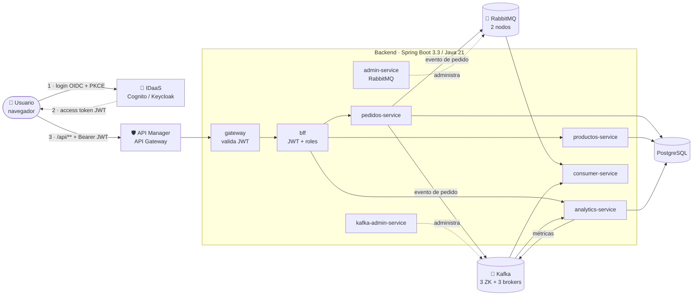

**Un pedido de punta a punta:**

1. El usuario inicia sesión en el **IDaaS** y obtiene un **access token JWT**.
2. Cada llamada pasa por el **API Manager**, que valida el JWT antes de tocar el backend.
3. El `gateway` y el `bff` validan de nuevo (defensa en profundidad) y el BFF aplica los **roles**.
4. `pedidos-service` guarda el pedido y, **después del commit**, publica el evento **a la vez** en:
   - **RabbitMQ** → trabajo transaccional: notificaciones, tickets y documentos (ACK manual + DLQ).
   - **Kafka** → streaming: métricas en tiempo real, alertas y reporting (consumer groups + DLT).
5. El dashboard de analítica del frontend se actualiza solo (refresco cada 3 s).

---

## 2. Estructura del repositorio

```text
Cloud-Native/
├── pedidos360-frontend/            Angular 18 · SPA con login OIDC (core / features / shared)
├── pedidos360-gateway/             Spring Cloud Gateway · valida JWT + secreto de origen
├── pedidos360-bff/                 Backend-For-Frontend · valida JWT, roles y enruta
├── pedidos360-pedidos-service/     CRUD de pedidos · productor RabbitMQ + Kafka
├── pedidos360-productos-service/   CRUD de productos
├── pedidos360-consumer-service/    Consumidores RabbitMQ (3 colas) + alertas Kafka
├── pedidos360-analytics-service/   Streaming Kafka · métricas, reporting y monitor de DLT
├── pedidos360-admin-service/       Administrador RabbitMQ (colas, exchanges, bindings)
├── pedidos360-kafka-admin-service/ Administrador Kafka (tópicos, configs, consumer groups)
├── infra/
│   ├── apps/                       docker-compose local (todo el stack) + scripts Kafka/RabbitMQ
│   │   ├── kafka/create-topics.sh  creación idempotente de tópicos (contenedor kafka-init)
│   │   └── rabbitmq/               configuración del clúster de 2 nodos
│   ├── aws/                        deploy.sh / destroy.sh + compose de las 2 EC2
│   └── keycloak/realm-export.json  realm local (usuarios, roles, cliente SPA)
├── docs/                           guías, despliegue, arquitectura Kafka, diagramas
├── CHANGELOG.md                    versiones (v1.0.0 → v1.3.0)
└── CONTRIBUTING.md                 modelo de ramas y convenciones
```

Cada microservicio Java sigue la misma estructura por capas: `controller` · `service` (lógica de
dominio) · `repository` / `entity` (JPA) · `dto` · `config` · `messaging` o `consumer`
(infraestructura de mensajería, **separada** de la lógica de negocio) · `exception`.

---

## 3. Componentes y puertos

| Componente | Responsabilidad | Puerto contenedor | Puerto host (local) |
|-----------|-----------------|:-----------------:|:-------------------:|
| `frontend` | SPA Angular (nginx) | 80 | **4200** |
| `gateway` | Punto de entrada, valida JWT | 8080 | **8080** |
| `bff` | Fachada del frontend, roles | 8080 | 8081 |
| `pedidos-service` | Pedidos + productor de eventos | 8081 | 8082 |
| `productos-service` | Productos | 8082 | 8083 |
| `consumer-service` | Consumidores RabbitMQ + alertas Kafka | 8083 | 8084 |
| `admin-service` | Admin RabbitMQ (REST) | 8084 | **8085** |
| `analytics-service` | Analítica Kafka | 8086 | 8086 |
| `kafka-admin-service` | Admin Kafka (REST) | 8087 | **8087** |
| `keycloak` | IDaaS local | 8080 | **8090** |
| `kafka-ui` | Consola de Kafka | 8080 | **8091** |
| `rabbitmq1` / `rabbitmq2` | Consola RabbitMQ | 15672 | **15672** / **15673** |
| `kafka1..3` | Brokers | 9092..9094 | 9092..9094 |
| `postgres` | Base de datos | 5432 | 5433 |

---

## 4. 🔑 IDaaS y seguridad (OAuth 2.0 / OIDC + JWT)

### 4.1 Quién es quién

| Pieza | Local | Nube | Qué hace |
|-------|-------|------|----------|
| **IDaaS** (proveedor de identidad) | Keycloak, realm `pedidos360` | Amazon Cognito, User Pool `pedidos360-tenant` | Autentica al usuario y **firma** el JWT |
| **Cliente OIDC** | `pedidos360-spa` | App client `pedidos360-spa` | La SPA: cliente público, sin secreto, usa **PKCE** |
| **Usuarios / roles** | `admin`, `operador`, `cliente` | Mismos usuarios en los grupos `ADMIN`, `OPERADOR`, `CLIENTE` | El rol viaja dentro del token |
| **API Manager** | Spring Cloud Gateway | Amazon API Gateway (HTTP API) con **JWT authorizer** | Rechaza tokens inválidos antes del backend |

El backend acepta los dos IDaaS sin cambiar código: lee la audiencia de `aud` (Keycloak) **o**
`client_id` (Cognito), y los roles de `realm_access.roles` (Keycloak) **o** `cognito:groups` (Cognito).

### 4.2 Login: Authorization Code + PKCE

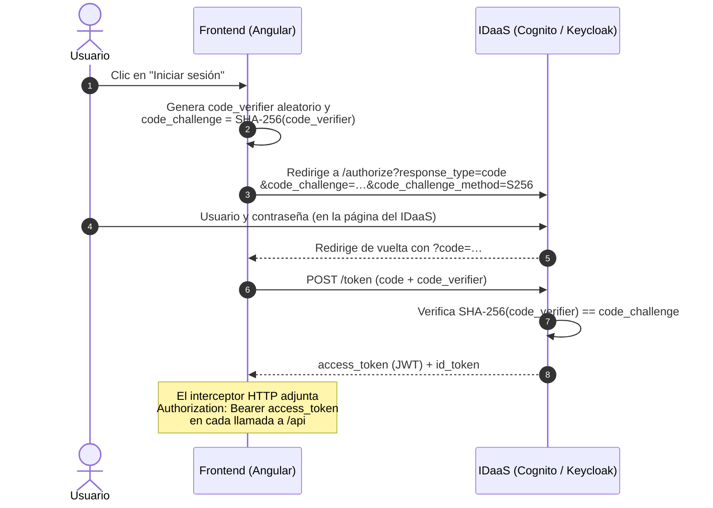

- La SPA **nunca ve la contraseña**: el login ocurre en la página del IDaaS.
- **PKCE** evita que un `code` interceptado sirva: sin el `code_verifier` original no se canjea.
- Librería: `angular-oauth2-oidc` (`core/auth`). La configuración OIDC (issuer, client id) se lee en
  **tiempo de ejecución** desde `/config.json`, así que la misma imagen sirve para cualquier cuenta.

### 4.3 Cadena de validación de una petición

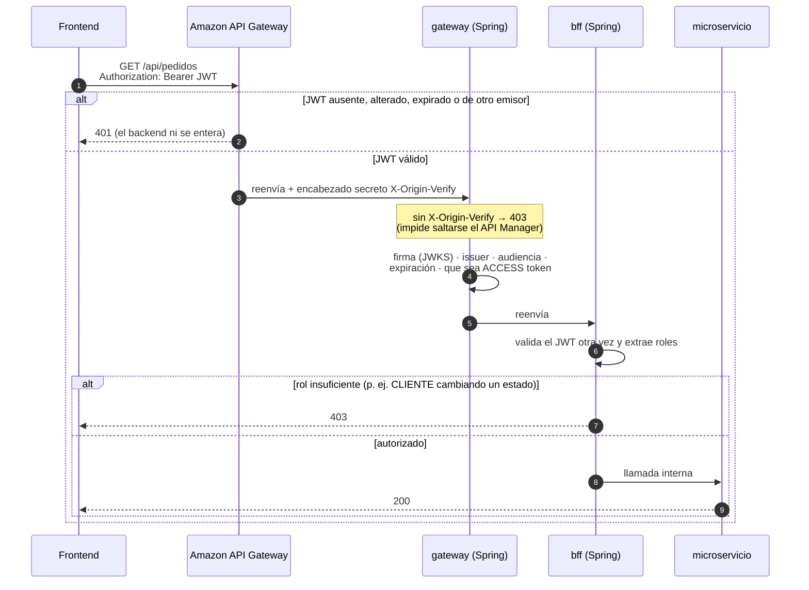

| Control | Dónde | Resultado si falla |
|---------|-------|--------------------|
| Firma RS256 contra las claves públicas (JWKS) del IDaaS | API Gateway, gateway, BFF | 401 |
| `iss` = issuer esperado · `exp` vigente | API Gateway, gateway, BFF | 401 |
| Audiencia: `aud` o `client_id` = cliente de la SPA | API Gateway, gateway, BFF | 401 |
| Debe ser **access token** (`token_use=access` / `typ=Bearer`); un ID token no autoriza | gateway, BFF | 401 |
| Encabezado `X-Origin-Verify` (secreto compartido con el API Gateway) | gateway (solo nube) | 403 |
| Rol del usuario (`ADMIN`, `OPERADOR`, `CLIENTE`) | BFF (`@PreAuthorize`) | 403 |

### 4.4 Anatomía del access token (Cognito)

```json
{
  "sub": "c4f8…",
  "cognito:groups": ["OPERADOR"],
  "iss": "https://cognito-idp.us-east-1.amazonaws.com/us-east-1_XXXX",
  "client_id": "3co912n6as17utm5q0a07upsrl",
  "token_use": "access",
  "scope": "openid profile email",
  "exp": 1763600000,
  "username": "operador"
}
```

Cabecera (`alg: RS256`, `kid`) + payload (claims) + firma. Si se altera **un solo byte** del payload,
la firma deja de coincidir → 401.

### 4.5 Permisos por rol

| Endpoint | Sin token | `cliente` | `operador` / `admin` |
|----------|:---------:|:---------:|:--------------------:|
| `GET /api/pedidos`, `/api/productos`, `/api/analitica/*` | 401 | 200 | 200 |
| `POST /api/pedidos` | 401 | 201 | 201 |
| `PATCH /api/pedidos/{id}/estado`, `DELETE /api/pedidos/{id}` | 401 | **403** | 200 / 204 |
| `POST/PUT/DELETE /api/productos` | 401 | **403** | 2xx |

En el frontend, los **guards** por rol ocultan las vistas que el usuario no puede usar; el backend
igualmente lo hace cumplir (la seguridad nunca depende solo del frontend).

---

## 5. 🐰 RabbitMQ — mensajería transaccional

RabbitMQ se usa para **trabajos que deben completarse una vez y confirmarse** (notificar, emitir
un ticket, generar un documento). Cada mensaje se confirma manualmente y, si no se puede procesar,
termina en una **Dead Letter Queue** en vez de perderse o bloquear la cola.

### 5.1 Clúster de 2 nodos

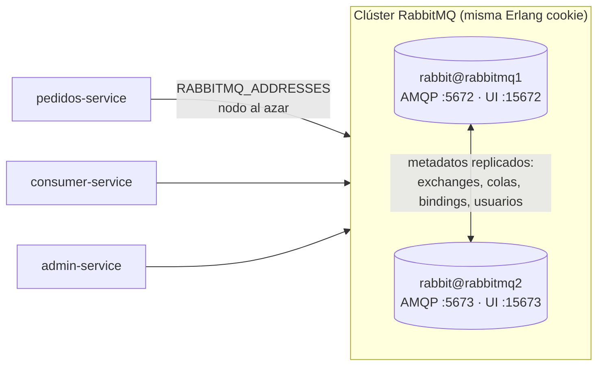

- `rabbitmq2` se une al clúster de `rabbitmq1` al arrancar (`cluster_formation` en `infra/apps/rabbitmq`).
- Los servicios conocen **ambos nodos** (`spring.rabbitmq.addresses`) y reparten sus conexiones al azar
  (`address-shuffle-mode: random`); si un nodo cae, reconectan al otro.
- Limitación conocida: las colas son *classic* y residen en `rabbitmq1`. Para que sobrevivan a la
  caída de ese nodo se requieren colas *quorum*, que necesitan al menos 3 nodos.

### 5.2 Topología: exchanges, colas y DLQ

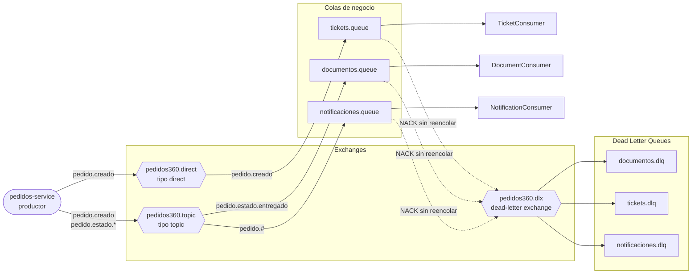

| Cola | Exchange · routing key | Para qué | DLQ |
|------|------------------------|----------|-----|
| `pedidos360.notificaciones.queue` | topic · `pedido.#` (todo evento de pedido) | Avisar al cliente | `pedidos360.notificaciones.dlq` |
| `pedidos360.tickets.queue` | direct · `pedido.creado` (coincidencia exacta) | Emitir ticket de compra | `pedidos360.tickets.dlq` |
| `pedidos360.documentos.queue` | topic · `pedido.estado.entregado` | Generar comprobante de entrega | `pedidos360.documentos.dlq` |

**Direct vs topic:** el *direct* entrega solo si la routing key coincide exactamente; el *topic*
admite comodines (`*` = una palabra, `#` = cero o más), por eso `pedido.#` recibe creaciones y todos
los cambios de estado. Cada cola declara `x-dead-letter-exchange = pedidos360.dlx` y su
`x-dead-letter-routing-key` apunta a su propia DLQ. Todos los nombres están centralizados en
`application.yml` (prefijo `pedidos360.rabbitmq`).

### 5.3 Ciclo de vida de un mensaje (ACK manual)

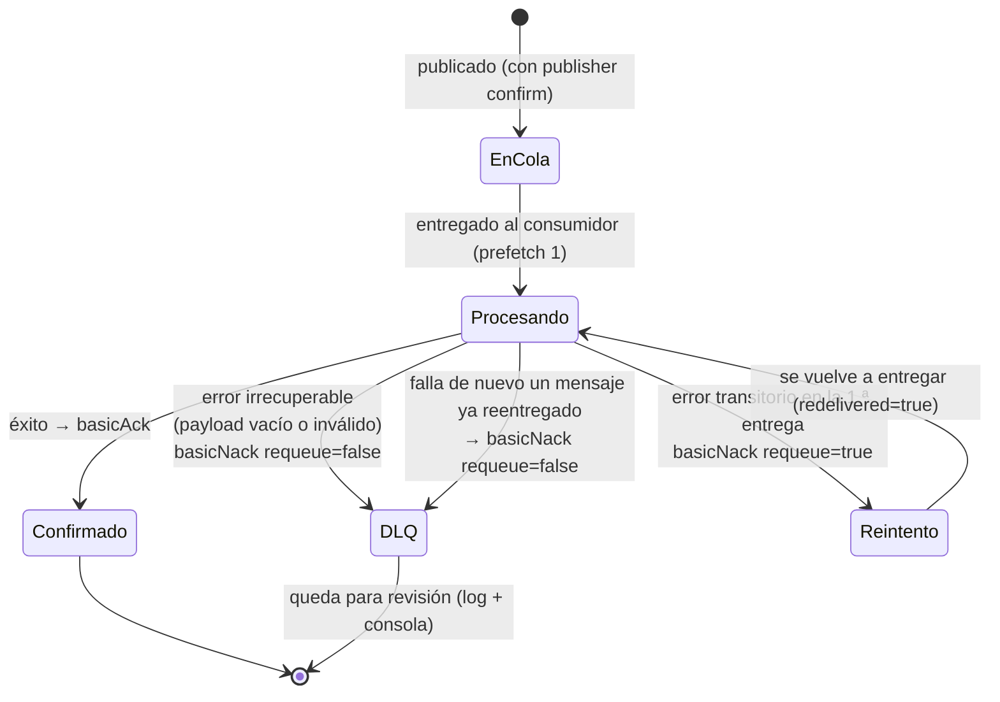

- **Productor confiable:** `publisher-confirm-type: correlated` (el broker confirma cada mensaje con
  su `correlationId`) y `publisher-returns` + `mandatory` (un mensaje sin ruta se registra, no se pierde).
- **Después del commit:** los eventos se publican solo si la transacción del pedido se confirmó.
- **Sin bucles infinitos:** `RechazoMensaje` centraliza la política: un error transitorio se reintenta
  **una vez**; si vuelve a fallar, va a la DLQ. Cada desvío queda en el log (`IRRECUPERABLE -> DLQ`).

### 5.4 Administrador de RabbitMQ (`admin-service`)

| Operación | Endpoint |
|-----------|----------|
| Crear / eliminar cola | `POST /api/v1/admin/queues` · `DELETE /api/v1/admin/queues/{name}` |
| Crear / eliminar exchange (`direct`, `topic`, `fanout`, `headers`) | `POST /api/v1/admin/exchanges` · `DELETE /api/v1/admin/exchanges/{name}` |
| Crear / eliminar binding | `POST /api/v1/admin/bindings` · `DELETE /api/v1/admin/bindings` |

Usa `AmqpAdmin` (abstracción de Spring AMQP); entradas inválidas (nombre vacío, tipo desconocido) → 400.

---

## 6. 🚀 Apache Kafka — streaming y analítica en tiempo real

Kafka **complementa** a RabbitMQ (no lo reemplaza): es un **log distribuido, particionado y
replicado** donde los eventos se conservan días y varios consumidores independientes los leen a su
ritmo. Se usa para analítica en tiempo real, alertas y reporting.

| | RabbitMQ | Kafka |
|---|---|---|
| Modelo | Cola: el mensaje se borra al confirmarse | Log: el mensaje se conserva (retención) |
| Lectores | Un consumidor procesa cada mensaje | Cada **consumer group** recibe **todos** los eventos |
| Releer | No | Sí (reset de offsets / replay) |
| En Pedidos360 | Notificaciones, tickets, documentos | Métricas, alertas, reporting |

### 6.1 Clúster de alta disponibilidad

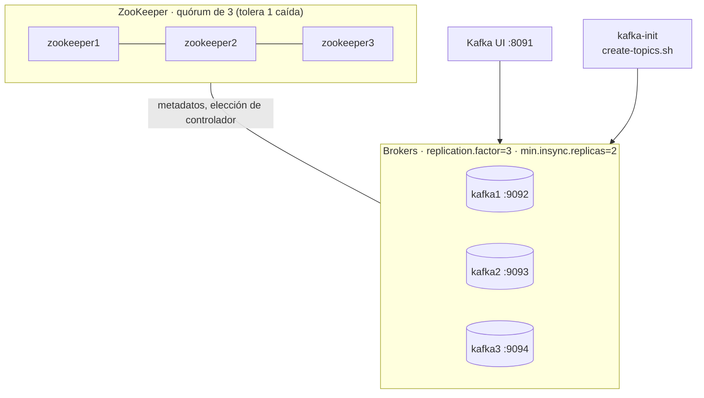

- Cada partición tiene **1 líder y 2 seguidores** en brokers distintos.
- Los productores usan `acks=all`: un mensaje se confirma cuando lo tienen **al menos 2 réplicas
  sincronizadas** (`min.insync.replicas=2`). **Si cae un broker, el clúster sigue escribiendo y
  leyendo**; al volver, se pone al día y recupera el ISR completo.
- `auto.create.topics.enable=false`: solo existen los tópicos definidos explícitamente.

### 6.2 Tópicos y parámetros

| Tópico | Particiones × réplicas | Key | `retention.ms` | `cleanup.policy` | Uso |
|--------|:---------------------:|-----|----------------|------------------|-----|
| `pedidos360.pedidos.eventos` | 3 × 3 | número de pedido | 7 días | `delete` | Eventos de dominio de cada pedido |
| `pedidos360.analitica.metricas` | 3 × 3 | estado | 30 días | `compact,delete` | Última métrica por estado |
| `pedidos360.pedidos.eventos.dlt` | 3 × 3 | (la original) | 7 días | `delete` | Auxiliar: mensajes defectuosos |

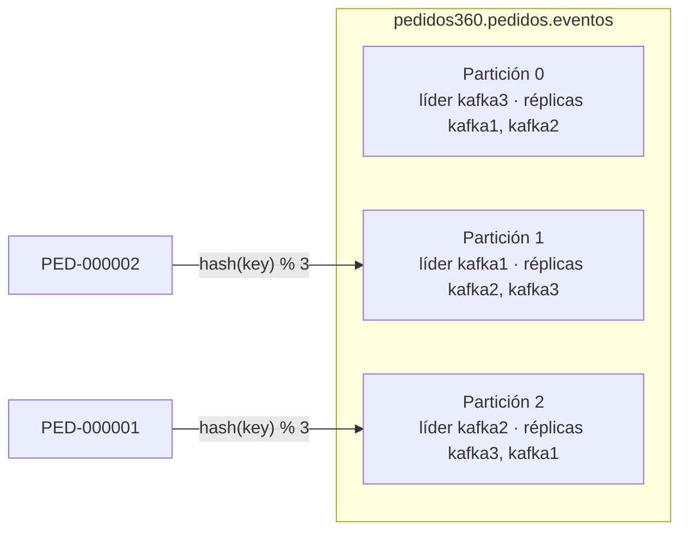

- **Key = número de pedido:** todos los eventos de un mismo pedido caen en la **misma partición** y se
  procesan **en orden** (creado → confirmado → enviado…).
- **`compact`** conserva solo el último valor por clave (estado): el tópico de métricas funciona como
  una tabla siempre actualizada; `delete` además descarta lo más antiguo que 30 días.
- Los tópicos se crean de forma idempotente con `infra/apps/kafka/create-topics.sh` (contenedor
  `kafka-init`, que también alinea la configuración de tópicos existentes) y con beans `NewTopic`.

### 6.3 Flujo de streaming de punta a punta

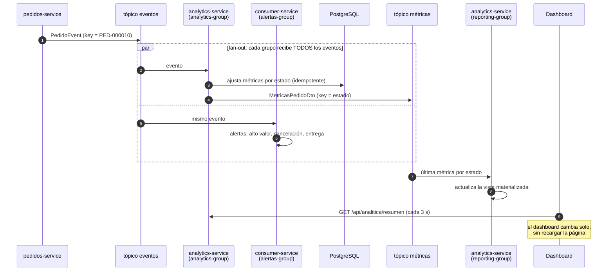

**Evento de dominio (`PedidoEvent`)** — DTO tipado, serializado como JSON:

```json
{
  "eventId": "8578f95a-b1e4-485b-b0a0-7cc51c8cf94b",
  "tipoEvento": "ESTADO_ACTUALIZADO",
  "ocurridoEn": "2026-11-19T21:25:10",
  "pedidoId": 9,
  "numero": "PED-000009",
  "cliente": "Cliente A",
  "estado": "CONFIRMADO",
  "total": 1700000.00,
  "fecha": "2026-11-19T21:23:00"
}
```

| Campo | Para qué |
|-------|----------|
| `eventId` | Identificador único: el consumidor descarta duplicados (idempotencia) |
| `tipoEvento` | `PEDIDO_CREADO`, `ESTADO_ACTUALIZADO`, `PEDIDO_ELIMINADO`: cada consumidor reacciona distinto |
| `numero` | Key del mensaje → partición y orden |
| `estado`, `total` | Agrupan las métricas y disparan alertas |

**Analítica correcta e idempotente:** `analytics-service` guarda el último estado conocido de cada
pedido (`pedido_estado_actual`). Un cambio de estado **resta 1** al estado anterior y **suma 1** al
nuevo; una eliminación descuenta; un `eventId` repetido se ignora. Así el total del dashboard
siempre coincide con los pedidos reales, aunque un evento llegue dos veces.

### 6.4 Consumer groups

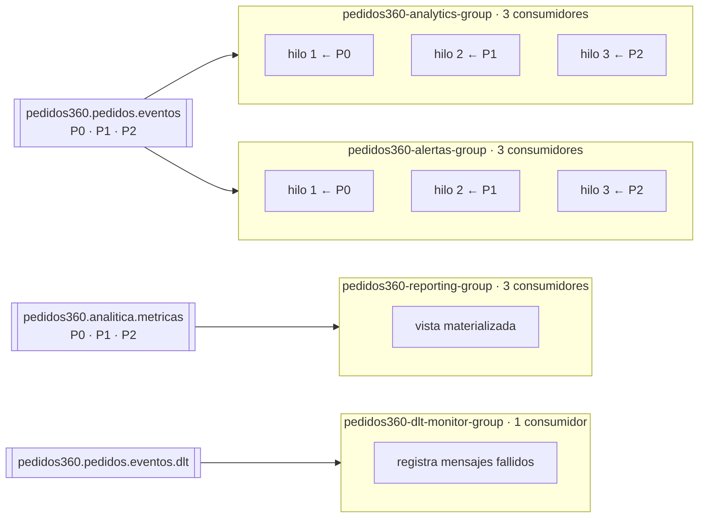

| Consumer group | Servicio | Tópico | Estrategia |
|----------------|----------|--------|------------|
| `pedidos360-analytics-group` | analytics-service | eventos | **Balanceo**: 3 hilos, una partición cada uno |
| `pedidos360-alertas-group` | consumer-service | eventos (el mismo) | **Fan-out**: otro grupo → recibe todos los eventos |
| `pedidos360-reporting-group` | analytics-service | métricas | Vista materializada; al arrancar relee el tópico compactado |
| `pedidos360-dlt-monitor-group` | analytics-service | DLT | Monitoreo de errores |

- **Dentro de un grupo** las particiones se reparten (escala horizontal y si un consumidor cae, otro
  toma sus particiones). **Entre grupos** cada uno recibe todo y guarda su propio offset.
- Offsets confirmados **por registro** y solo después de procesar (`enable.auto.commit=false`,
  `AckMode.RECORD`): un fallo nunca pierde eventos.

### 6.5 Manejo de errores y Dead Letter Topic

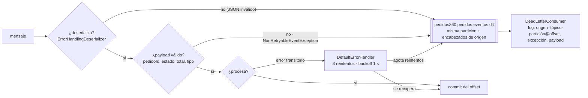

Un mensaje defectuoso **no detiene la partición**: se aparta a la DLT y el consumo continúa.
`consumer-service` aplica el mismo esquema (2 reintentos, backoff 500 ms) y descarta con log.

### 6.6 Configuración del cliente Kafka

| Lado | Propiedad | Valor | Por qué |
|------|-----------|-------|---------|
| Ambos | `bootstrap-servers` | `kafka1:29092,kafka2:29093,kafka3:29094` (env `KAFKA_BOOTSTRAP_SERVERS`) | Los 3 brokers |
| Productor | serializers | `StringSerializer` / `JsonSerializer` (sin type headers) | JSON interoperable |
| Productor | `acks` · `enable.idempotence` · `retries` | `all` · `true` · `3` | Sin pérdidas ni duplicados |
| Consumidor | deserializer | `ErrorHandlingDeserializer` → `JsonDeserializer` tipado | Un JSON roto no rompe el `poll()` |
| Consumidor | `enable.auto.commit` · `AckMode` | `false` · `RECORD` | Commit solo tras procesar |
| Consumidor | `auto.offset.reset` · `concurrency` | `earliest` · `3` | No perder eventos · 1 hilo por partición |

Centralizada en `KafkaProducerConfig` / `KafkaConsumerConfig` de cada servicio; nombres de tópicos y
grupos en `application.yml` (prefijo `pedidos360.kafka`).

### 6.7 Administrador de Kafka (`kafka-admin-service`)

| Operación | Endpoint |
|-----------|----------|
| Crear tópico (particiones, réplicas, configs) | `POST /api/v1/kafka/topics` |
| Listar / inspeccionar | `GET /api/v1/kafka/topics` · `GET /api/v1/kafka/topics/{name}` |
| Modificar configuración (`retention.ms`, `cleanup.policy`…) | `PUT /api/v1/kafka/topics/{name}/configs` |
| Aumentar particiones | `POST /api/v1/kafka/topics/{name}/partitions` |
| Eliminar tópico | `DELETE /api/v1/kafka/topics/{name}` |
| Estado del clúster (brokers, controlador) | `GET /api/v1/kafka/cluster` |
| Consumer groups: listar / detalle / offsets + **lag** | `GET /api/v1/kafka/consumer-groups[/{id}[/offsets]]` |
| Reset de offsets (earliest/latest) · eliminar grupo | `POST …/{id}/offsets/reset` · `DELETE …/{id}` |

### 6.8 Observabilidad

- **Kafka UI** (`:8091`): *Brokers* (3 en línea), *Topics* (particiones, réplicas, configuración,
  mensajes), *Consumers* (miembros, particiones asignadas, offsets y **lag** por grupo).
- **CLI** (dentro de un broker):

```bash
kafka-topics --bootstrap-server localhost:29092 --describe                      # líderes, réplicas, ISR
kafka-topics --bootstrap-server localhost:29092 --describe --under-replicated-partitions
kafka-consumer-groups --bootstrap-server localhost:29092 --describe --all-groups --state
kafka-consumer-groups --bootstrap-server localhost:29092 --describe --group pedidos360-analytics-group
```

Más detalle: [`docs/ARQUITECTURA_KAFKA.md`](docs/ARQUITECTURA_KAFKA.md).

---

## 7. ☁️ Despliegue en AWS

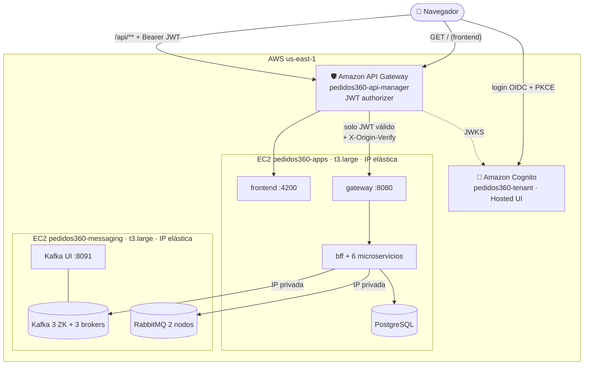

| Decisión | Motivo |
|----------|--------|
| API Gateway + Cognito administrados | Cumplen *API Manager* e *IDaaS* sin operar servidores propios |
| Validación del JWT en 3 capas | Defensa en profundidad; llamar directo a la EC2 responde 403 |
| 2 EC2 con IP elástica | Límite de tamaño del Learner Lab; IPs fijas entre sesiones |
| Brokers por IP privada | Kafka y RabbitMQ no quedan expuestos a Internet |
| PostgreSQL en la EC2 de apps | Decisión del equipo (contenedor con volumen persistente) |
| `/config.json` en tiempo de ejecución | La misma imagen del frontend sirve para cualquier cuenta |

```bash
bash infra/aws/deploy.sh               # crea o actualiza todo (idempotente) y verifica 401/200/403
SKIP_CODE=1 bash infra/aws/deploy.sh   # sesión nueva del lab: enciende EC2 y actualiza tu IP
bash infra/aws/destroy.sh              # elimina todos los recursos
```

Prerrequisitos: credenciales del lab en `~/.aws/credentials` y la llave en `~/.ssh/labsuser.pem`.
Al terminar, `deploy.sh` imprime la URL, los usuarios y las IPs. Detalle:
[`docs/DESPLIEGUE_AWS.md`](docs/DESPLIEGUE_AWS.md).

---

## 8. 💻 Ejecución local y pruebas

**Requisitos:** Java 21, Maven 3.9+, Node 18+, Docker y Docker Compose.

```bash
cd infra/apps
cp .env.example .env          # los valores por defecto funcionan en local
docker compose up --build     # stack completo: IDaaS, mensajería, 8 servicios y frontend
```

Abrir `http://localhost:4200` e iniciar sesión con un usuario de
[`docs/CREDENCIALES_DEMO.md`](docs/CREDENCIALES_DEMO.md) (Keycloak importa el realm al arrancar).

**Pruebas** (68 pruebas automatizadas en los 8 servicios):

```bash
for s in pedidos360-*-service pedidos360-bff pedidos360-gateway; do
  mvn -q -f "$s/pom.xml" clean verify || echo "FALLÓ: $s"
done
cd pedidos360-frontend && npm ci && npx ng build --configuration production
```

---

## 9. 🔎 Verificación en vivo (checklists)

Comandos para el entorno local (`cd infra/apps`). En AWS, los mismos comandos se ejecutan por SSH
en la EC2 correspondiente.

### IDaaS / JWT

1. Abrir la app → **Iniciar sesión** → redirige al IDaaS (`response_type=code`, `code_challenge_method=S256`).
2. Sin token: `curl -i http://localhost:8080/api/pedidos` → **401**.
3. Con token de `cliente`: `GET /api/pedidos` → **200**; `PATCH /api/pedidos/1/estado` → **403**.

### RabbitMQ

1. Clúster: `docker compose exec rabbitmq1 rabbitmq-diagnostics cluster_status` → 2 nodos.
2. Topología: consola `http://localhost:15672` → *Exchanges* (topic, direct, dlx) y *Queues* (3 + 3 DLQ).
3. Flujo: crear un pedido y ver `PROCESADO_OK` en `docker compose logs consumer-service`.
4. DLQ: en la consola, *Queues → pedidos360.notificaciones.queue → Publish message* con cuerpo vacío
   → aparece en `pedidos360.notificaciones.dlq` y en el log `IRRECUPERABLE -> DLQ`.
5. Admin:

```bash
curl -X POST   http://localhost:8085/api/v1/admin/queues    -H "Content-Type: application/json" -d '{"name":"demo.queue"}'
curl -X POST   http://localhost:8085/api/v1/admin/exchanges -H "Content-Type: application/json" -d '{"name":"demo.exchange","type":"direct"}'
curl -X POST   http://localhost:8085/api/v1/admin/bindings  -H "Content-Type: application/json" -d '{"queue":"demo.queue","exchange":"demo.exchange","routingKey":"demo"}'
curl -X DELETE http://localhost:8085/api/v1/admin/bindings  -H "Content-Type: application/json" -d '{"queue":"demo.queue","exchange":"demo.exchange","routingKey":"demo"}'
curl -X DELETE http://localhost:8085/api/v1/admin/exchanges/demo.exchange
curl -X DELETE http://localhost:8085/api/v1/admin/queues/demo.queue
```

### Kafka

1. Tópicos 3×3: `docker compose exec kafka1 kafka-topics --bootstrap-server localhost:29092 --describe`.
2. Streaming: crear un pedido y ver `[analitica] evento aplicado` y `[alertas] ALERTA` en los logs
   de `analytics-service` y `consumer-service` (fan-out); el dashboard *Analítica* se actualiza solo.
3. Lag: Kafka UI → *Consumers*, o `kafka-consumer-groups --describe --all-groups`.
4. Tolerancia a fallos: `docker compose stop kafka2` → crear o actualizar un pedido sigue funcionando →
   `docker compose start kafka2` → `--under-replicated-partitions` vuelve a quedar vacío.
5. DLT (mensaje defectuoso que no bloquea la partición):

```bash
echo 'PED-X:esto no es json' | docker compose exec -T kafka1 kafka-console-producer \
  --bootstrap-server localhost:29092 --topic pedidos360.pedidos.eventos \
  --property parse.key=true --property key.separator=:
docker compose logs analytics-service | grep "dlt-monitor"
```

6. Admin:

```bash
curl -X POST http://localhost:8087/api/v1/kafka/topics -H "Content-Type: application/json" \
  -d '{"name":"demo.topic","partitions":3,"replicas":3}'
curl -X PUT  http://localhost:8087/api/v1/kafka/topics/demo.topic/configs -H "Content-Type: application/json" \
  -d '{"configs":{"retention.ms":"7200000"}}'
curl -X POST http://localhost:8087/api/v1/kafka/topics/demo.topic/partitions -H "Content-Type: application/json" \
  -d '{"totalPartitions":6}'
curl http://localhost:8087/api/v1/kafka/consumer-groups/pedidos360-analytics-group/offsets
curl -X DELETE http://localhost:8087/api/v1/kafka/topics/demo.topic
```

---

## 10. 📖 Documentación y glosario

| Documento | Contenido |
|-----------|-----------|
| [`docs/CREDENCIALES_DEMO.md`](docs/CREDENCIALES_DEMO.md) | Usuarios de prueba de la app y permisos |
| [`docs/DESPLIEGUE_AWS.md`](docs/DESPLIEGUE_AWS.md) | Despliegue en AWS y guion de demo |
| [`docs/ARQUITECTURA_KAFKA.md`](docs/ARQUITECTURA_KAFKA.md) | Kafka en detalle: tolerancia a fallos, paralelismo, errores |
| [`docs/ESTADO_Y_CONTEXTO.md`](docs/ESTADO_Y_CONTEXTO.md) | Estado actual y checklist del día de la presentación |
| [`docs/GUIA_DE_ESTUDIO_EP5.md`](docs/GUIA_DE_ESTUDIO_EP5.md) | Guía desde cero con analogías, diagramas y autoevaluación |
| [`docs/GUIA_DE_ESTUDIO_EP4.md`](docs/GUIA_DE_ESTUDIO_EP4.md) | Guía de la entrega anterior (RabbitMQ) |
| [`docs/guia.md`](docs/guia.md) | Despliegue y pruebas en Docker local |
| [`CHANGELOG.md`](CHANGELOG.md) | Cambios por versión |

| Concepto | En una frase |
|----------|--------------|
| **IDaaS** | Identidad como servicio: autentica usuarios y emite tokens firmados (Cognito, Keycloak) |
| **OIDC / OAuth 2.0** | Estándares de login y autorización; *Authorization Code + PKCE* es el flujo seguro para SPAs |
| **JWT** | Token firmado con los datos del usuario (claims); el backend lo verifica sin consultar al IDaaS |
| **API Manager** | Puerta de entrada única que valida tokens y enruta (Amazon API Gateway) |
| **Exchange** | Router de RabbitMQ: decide a qué cola va un mensaje según la routing key |
| **DLQ / DLT** | Cola / tópico donde terminan los mensajes que no se pudieron procesar |
| **ACK / NACK** | Confirmación manual: procesado / rechazado (reintentar o desviar a la DLQ) |
| **Tópico / partición** | Canal de Kafka y su subdivisión; las particiones permiten paralelismo |
| **Réplica / ISR** | Copias de una partición en otros brokers; ISR = las que están al día |
| **Offset / lag** | Posición leída por un grupo / cuántos mensajes le faltan por leer |
| **Consumer group** | Consumidores que se reparten particiones; grupos distintos reciben todo (fan-out) |
| **retention / cleanup.policy** | Cuánto se conservan los mensajes · `delete` por tiempo, `compact` último valor por clave |

**Ramas:** `feature/*` / `fix/*` → `develop` → `main` vía Pull Request; versiones con tag `vX.Y.Z`
(ver [`CONTRIBUTING.md`](CONTRIBUTING.md)).
