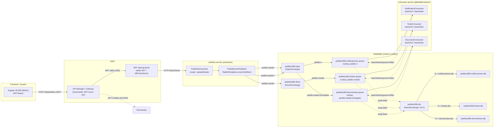
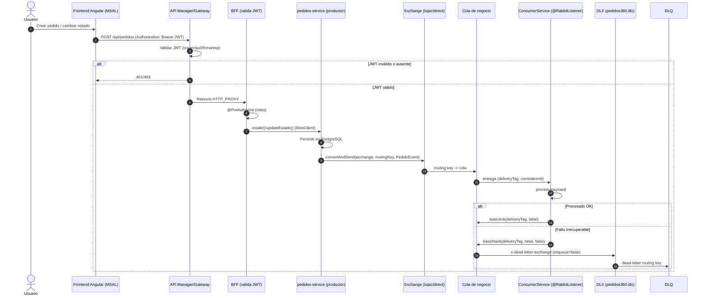

# Informe de Auditoría — Mensajería Asíncrona RabbitMQ (Pedidos360)

**Fecha:** 15 de octubre de 2026
**Alcance:** `pedidos360-consumer-service`, `pedidos360-pedidos-service` (productor), `pedidos360-admin-service`, `infra/apps/docker-compose.yml`, BFF y frontend.
**Criterio:** Rúbricas EP3 (indicadores RabbitMQ) y EP4 (infraestructura/despliegue) de Duoc UC.

## Tabla resumen de cumplimiento

| # | Indicador | Veredicto | Evidencia |
|---|-----------|-----------|-----------|
| 1 | Centralización de configuración | ✅ **Cumple** | `application.yml` + `@ConfigurationProperties` |
| 2 | Beans explícitos (Queue/Exchange/Binding) | ✅ **Cumple** | `RabbitMQConfig.java` |
| 2b | DLQ + DLX definidos explícitamente | ✅ **Cumple** | `RabbitMQConfig.java` (L74–137) |
| 3 | Aislamiento arquitectónico | ⚠️ **Parcial** | Bien aislado, pero el productor no declara su topología |
| 4 | Consumidores + ACK manual + resiliencia | ⚠️ **Parcial** | ACK/NACK correcto, falta manejo de excepción no controlada |
| 5 | Microservicio administrador | ✅ **Cumple** | `RabbitAdminService` + DTOs validados |
| 6 | Clúster 2 nodos (docker-compose) | ❌ **No cumple** | `CLUSTER_WITH` no une el nodo 2 automáticamente |

---

# MÓDULO 1: AUDITORÍA DEL CÓDIGO ACTUAL VS. RÚBRICA EP3 & EP4

## 1.1 Centralización de Configuración — ✅ CUMPLE

Todos los nombres de colas, exchanges, DLX y routing keys están centralizados. **No hay strings literales "quemados"** en controladores, servicios ni escuchadores.

**Evidencia:**
- `pedidos360-consumer-service/src/main/resources/application.yml` (L17–31): define `pedidos360.rabbitmq.*`.
- `pedidos360-consumer-service/.../config/RabbitMQProperties.java` (L10–24): `@ConfigurationProperties(prefix = "pedidos360.rabbitmq")` como `record` inmutable.
- `pedidos360-pedidos-service/.../messaging/RabbitMQProducerProperties.java` + su `application.yml` (L24–30): mismas claves para el productor.
- Los `@RabbitListener` usan placeholders `${pedidos360.rabbitmq.queue-...}`, no literales.

Verificación por grep: `pedidos360.(topic|direct|dlx|...)` → **0 coincidencias** en `*.java`. Confirmado: cero hardcoding.

> **Nota menor:** el placeholder `${...}` dentro de la anotación `@RabbitListener` es una referencia a config (correcto), no un literal de nombre. No resta puntaje.

## 1.2 Declaración de Beans Explícitos — ✅ CUMPLE

`pedidos360-consumer-service/.../config/RabbitMQConfig.java` declara explícitamente **todo**:

| Elemento | Bean | Línea |
|---|---|---|
| `TopicExchange` | `pedidosTopicExchange()` → `pedidos360.topic` | 33–36 |
| `DirectExchange` | `pedidosDirectExchange()` → `pedidos360.direct` | 38–41 |
| `DirectExchange` (DLX) | `pedidosDlxExchange()` → `pedidos360.dlx` | 43–46 |
| 3 colas de negocio | `notificacionesQueue()`, `ticketsQueue()`, `documentosQueue()` | 50–72 |
| 3 DLQ | `notificacionesDlq()`, `ticketsDlq()`, `documentosDlq()` | 76–89 |
| 2 bindings topic | `notificacionesBinding()` (`pedido.#`), `documentosBinding()` (`pedido.estado.entregado`) | 93–105 |
| 1 binding direct | `ticketsBinding()` (`pedido.creado`) | 109–114 |
| 3 bindings DLQ→DLX | `notificacionesDlqBinding()`, etc. | 118–137 |

Las colas de negocio usan `QueueBuilder.durable(...).deadLetterExchange(dlx).deadLetterRoutingKey(...)`. **Todo correcto y explícito.**

> **Observación de diseño (no bloqueante):** la DLQ usa el *nombre de la cola* como routing key (`.deadLetterRoutingKey(props.queueNotificacionesDlq())` y el binding `with(props.queueNotificacionesDlq())`). Funciona, pero es más limpio definir routing keys de DLQ dedicadas (`routing.dlq.notificaciones`).

## 1.3 Aislamiento Arquitectónico — ⚠️ PARCIAL

**Lo correcto:**
- La configuración vive 100% en `config/` y `messaging/`. Ningún `@Controller` ni servicio de dominio toca `Channel`, `Connection` ni `Queue`/`Exchange`.
- El productor usa solo `RabbitTemplate` (abstracción inyectada) en `PedidoEventPublisher.java`.
- Los consumidores solo reciben `Message`/`Channel`/`deliveryTag` (firma estándar del listener), sin configurar infraestructura.

**Oportunidad de mejora (el "parcial"):** el productor (`pedidos-service`) **no declara** los exchanges a los que publica. Publica a `pedidos360.topic` y `pedidos360.direct` (L34–35 de `PedidoEventPublisher`) asumiendo que ya existen, porque los declara el `consumer-service`. Si el `consumer-service` no está levantado o arranca después, la publicación falla silenciosamente. Para robustez (y "Nivel Destacado"), la topología debería estar garantizada por quien publica o por un declarador común.

## 1.4 Consumidores (@RabbitListener) y Resiliencia — ⚠️ PARCIAL

**Lo correcto:**
- Consumidores **agrupados estrictamente por dominio**: `notifications/consumer/`, `tickets/consumer/`, `documents/consumer/`.
- `acknowledge-mode: manual` + `prefetch: 1` en `application.yml` (L12–15).
- Firma correcta: `Message + Channel + @Header(AmqpHeaders.DELIVERY_TAG) long deliveryTag`.
- Éxito → `channel.basicAck(deliveryTag, false)`; fallo → `channel.basicNack(deliveryTag, false, false)` (requeue=false → DLQ).

**El "parcial" — qué pasa con una excepción NO controlada:**

Los `process(...)` están envueltos en `try/catch`, pero **el método `@RabbitListener` declara `throws IOException`** (por `basicAck`/`basicNack`). Si el `Channel` está cerrado (broker reiniciado) o cualquier excepción escapa del `try` (p. ej. un error en el propio `basicNack`), la excepción se propaga al contenedor y **no existía** ningún `SimpleRabbitListenerContainerFactory` con `defaultRequeueRejected(false)` (confirmado por grep: 0 coincidencias de `SimpleRabbitListenerContainerFactory`/`defaultRequeueRejected`).

**Consecuencia:** con el default de Spring AMQP (`defaultRequeueRejected = true`), una excepción no controlada **reencola el mensaje infinitamente** (redelivery loop), sin pasar por la DLQ.

## 1.5 Microservicio Administrador — ✅ CUMPLE

- **Endpoints REST claros** (`RabbitAdminController.java`, `@RequestMapping("/api/v1/admin")`):
  - `POST /queues`, `DELETE /queues/{name}`
  - `POST /exchanges`, `DELETE /exchanges/{name}`
  - `POST /bindings`
- **Lógica encapsulada** en `RabbitAdminService` usando `AmqpAdmin` (bean `RabbitAdmin` en `RabbitMQAdminConfig.java`). Los controladores **no** tocan primitivas del broker.
- **DTOs validados** con `@NotBlank`/`@Size` (`QueueRequest`, `ExchangeRequest`, `BindingRequest`) y `@Valid` + `@Validated` en el controller.
- **Manejo 400** centralizado en `GlobalExceptionHandler` (`MethodArgumentNotValidException` → 400 con detalle; `IllegalArgumentException` → 400). El tipo de exchange inválido (`"foo"`) lanza `IllegalArgumentException` → 400.

## 1.6 Infraestructura (EP4) — ❌ NO CUMPLE (clúster)

- ✅ `docker-compose.yml` declara `rabbitmq1` y `rabbitmq2` con la **misma `RABBITMQ_ERLANG_COOKIE`** (L23, L39) y la imagen `rabbitmq:3.13-management` (plugin de management incluido, puertos 15672/15673).
- ✅ Existen **3 colas de negocio + 3 DLQ** (declaradas como beans en `consumer-service`).
- ❌ **El clúster de 2 nodos NO se forma automáticamente.** El `docker-compose` usa la variable `CLUSTER_WITH: rabbitmq1` (L42), que **no es una variable reconocida por la imagen oficial de RabbitMQ**. La propia bitácora lo confirma en `docs/BITACORA.md` §8.4. Además, el `healthcheck` de `rabbitmq2` solo comprueba `check_running` (no `cluster_status`), por lo que el compose reporta "healthy" aunque el nodo **no esté en el clúster**.

**Conclusión del Módulo 1:** el código de mensajería está muy sólido (centralización, beans, ACK manual, administrador). Los dos huecos que impiden "Nivel Destacado" son: **(a)** ausencia de un `SimpleRabbitListenerContainerFactory` resiliente para excepciones no controladas, y **(b)** el clúster RabbitMQ que no se une solo en `docker-compose`.

---

# MÓDULO 2: PLAN DE MEJORA Y REFACTORIZACIÓN

## 2.1 (Crítico) `SimpleRabbitListenerContainerFactory` resiliente

**Archivo:** `pedidos360-consumer-service/.../config/RabbitMQConfig.java`

```java
@Bean
public SimpleRabbitListenerContainerFactory rabbitListenerContainerFactory(
        SimpleRabbitListenerContainerFactoryConfigurer configurer,
        ConnectionFactory connectionFactory) {
    SimpleRabbitListenerContainerFactory factory = new SimpleRabbitListenerContainerFactory();
    configurer.configure(factory, connectionFactory);
    factory.setAcknowledgeMode(AcknowledgeMode.MANUAL);
    factory.setDefaultRequeueRejected(false); // excepción no controlada -> NACK sin requeue -> DLQ
    return factory;
}
```

Con `defaultRequeueRejected(false)`, si una excepción escapa del listener (Channel cerrado, `IOException`), el contenedor rechaza sin reencolar y, al tener la cola su `dead-letter-exchange`, el mensaje **va a la DLQ** en lugar de entrar en redelivery infinito.

## 2.2 (Robustez) El productor debe garantizar su topología + JSON tipado

**Archivo:** `pedidos360-pedidos-service/.../messaging/RabbitMQProducerConfig.java`

```java
@Configuration
@EnableConfigurationProperties(RabbitMQProducerProperties.class)
public class RabbitMQProducerConfig {

    @Bean public TopicExchange pedidosTopicExchange() { ... }
    @Bean public DirectExchange pedidosDirectExchange() { ... }

    @Bean
    public Jackson2JsonMessageConverter messageConverter() { return new Jackson2JsonMessageConverter(); }

    @Bean
    public RabbitTemplate rabbitTemplate(ConnectionFactory cf, Jackson2JsonMessageConverter converter) {
        RabbitTemplate t = new RabbitTemplate(cf);
        t.setMessageConverter(converter);
        t.setMandatory(true);
        t.setConfirmCallback((correlationData, ack, cause) -> { if (!ack) log.error(...); });
        t.setReturnsCallback(...);
        return t;
    }
}
```

**Refactor del publicador** para objetos tipados + `correlationId` (correlación con `MessageProperties`):

```java
private void publish(String exchange, String routingKey, PedidoEvent event) {
    CorrelationData correlation = new CorrelationData(UUID.randomUUID().toString());
    rabbitTemplate.convertAndSend(exchange, routingKey, event, msg -> {
        msg.getMessageProperties().setCorrelationId(correlation.getId());
        msg.getMessageProperties().setContentType(MessageProperties.CONTENT_TYPE_JSON);
        return msg;
    }, correlation);
}
```

## 2.3 (Buenas prácticas) Consumidores con payload tipado + DLQ

Consumir `PedidoEvent` deserializado (requiere `Jackson2JsonMessageConverter` en el consumer) y usar el header `CORRELATION_ID` para trazabilidad. Extraer la lógica `try/catch + ack/nack` a una clase base o `RabbitListenerErrorHandler` para no duplicarla (DRY).

## 2.4 (Validación) Endurecer los DTOs del administrador

Añadir `@Pattern` a `ExchangeRequest.name` (`^[A-Za-z0-9_.-]+$`), `ExchangeRequest.type` (`(?i)^(direct|topic|fanout|headers)$`), y el mismo patrón de nombre a `QueueRequest.name` y `BindingRequest.queue/exchange`. Para `routingKey` usar `^[A-Za-z0-9._*#-]+$` (admite comodines `*` y `#`).

## 2.5 (Crítico EP4) Clúster RabbitMQ que se une automáticamente

**Archivo:** `infra/apps/docker-compose.yml` + `infra/apps/rabbitmq/rabbitmq.conf`

Se elimina `CLUSTER_WITH` (no reconocido) y se usa **peer discovery clásico** con un `rabbitmq.conf` montado en ambos nodos:

```
cluster_formation.peer_discovery_backend = rabbit_peer_discovery_classic_config
cluster_formation.classic_config.nodes.1 = rabbit@rabbitmq1
cluster_formation.classic_config.nodes.2 = rabbit@rabbitmq2
cluster_formation.node_cleanup.only_log_warning = true
```

El healthcheck de `rabbitmq2` pasa a verificar membresía real: `rabbitmqctl cluster_status | grep -q 'rabbit@rabbitmq1'`.

Verificación: `docker exec infra-apps-rabbitmq1-1 rabbitmq-diagnostics cluster_status` debe listar **2 nodos**.

## 2.6 Optimizaciones de rendimiento y buenas prácticas (checklist)

| Tema | Recomendación |
|---|---|
| **Prefetch** | `prefetch: 1` garantiza orden estricto pero limita throughput. Subir a 10–50 si el orden por mensaje no es crítico. |
| **Publisher confirms** | Activar `setConfirmCallback` + `CorrelationData` para detectar publicaciones no confirmadas. |
| **Publisher returns** | `setMandatory(true)` + `ReturnsCallback` para detectar mensajes sin ruta y no perderlos en silencio. |
| **Correlación** | Usar `MessageProperties.setCorrelationId()` + header `CORRELATION_ID` en el consumidor para trazabilidad extremo a extremo. |
| **Dead-letter routing keys dinámicas** | En vez de `routingKey = nombre de DLQ`, definir `routing.dlq.notificaciones`, etc. |
| **DLQ con TTL/retry** | Si se requiere reintento, colas de retry con `x-message-ttl` + `x-dead-letter-exchange` apuntando de vuelta a la principal (backoff) antes del DLQ final. |
| **Idempotencia** | Consumidores idempotentes (dedup por `correlationId`/`pedidoId`) porque RabbitMQ entrega *at-least-once*. |

---

# MÓDULO 3: DIAGRAMA E INSTRUCCIONES DEL FLUJO DE COLAS DE LA WEB

## 3.1 Flujo Paso a Paso

1. **Acción del usuario (Frontend Angular 18 + MSAL).** El usuario se autentica (Authorization Code + PKCE contra Azure AD) y realiza una acción, p. ej. *"Crear pedido"* o *"Cambiar estado a ENTREGADO"*. El SPA llama a `https://<api-gateway>.execute-api.../api/pedidos` con `Authorization: Bearer <JWT>`.
2. **API Manager / Gateway (AWS API Gateway + autorizador JWT).** Valida el JWT (issuer/audiencia/firma/exp de Azure AD): token válido → reenvía a la integración HTTP_PROXY → **BFF** (`http://<ip>:8080/api/{proxy}`); sin token o inválido/expirado → **HTTP 401/403**.
3. **BFF (Backend-For-Frontend).** Valida de nuevo el JWT (`oauth2ResourceServer`) y aplica autorización fina (`@PreAuthorize`). Enruta vía `RestClient` al microservicio de pedidos (`pedidos-service:8081`).
4. **Microservicio productor (`pedidos-service`).** `PedidoServiceImpl.create()`/`updateEstado()` persiste en PostgreSQL y `PedidoEventPublisher` publica vía `RabbitTemplate`:
   - `pedido.creado` → **`pedidos360.topic`** (topic) y → **`pedidos360.direct`** (direct).
   - `pedido.estado.<estado>` → **`pedidos360.topic`** (p. ej. `pedido.estado.entregado`).
5. **Routing Keys → Colas de negocio** (bindings declarados en `consumer-service`):
   - `pedido.#` → **`pedidos360.notificaciones.queue`** (recibe todo).
   - `pedido.creado` (direct) → **`pedidos360.tickets.queue`**.
   - `pedido.estado.entregado` → **`pedidos360.documentos.queue`**.
6. **Consumidores (`@RabbitListener`, ACK manual, `prefetch`).** Éxito → `channel.basicAck(deliveryTag, false)`; fallo irrecuperable → `channel.basicNack(deliveryTag, false, false)` → la cola reenvía el mensaje a su DLX por `x-dead-letter-exchange`.
7. **Manejo de error → DLQ.** El DLX **`pedidos360.dlx`** (direct) enruta por dead-letter routing key a la DLQ correspondiente:
   - `pedidos360.notificaciones.queue` → `pedidos360.notificaciones.dlq`
   - `pedidos360.tickets.queue` → `pedidos360.tickets.dlq`
   - `pedidos360.documentos.queue` → `pedidos360.documentos.dlq`

## 3.2 Diagrama de Arquitectura (Mermaid `graph LR`)



## 3.3 Diagrama de Secuencia (Mermaid `sequenceDiagram`)



## 3.4 Guía para Graficar en Draw.io / Lucidchart / Canva

**Componentes y figuras recomendadas:**

| Componente | Figura sugerida | Color |
|---|---|---|
| Frontend (Angular) | Rectángulo redondeado | Azul claro `#D6E4FF` |
| API Manager / Gateway | Rectángulo (con candado JWT) | Gris/azul `#B3C7E6` |
| BFF | Rectángulo redondeado | Azul `#9DC3E6` |
| Productor (pedidos-service) | Rectángulo | Azul `#5B9BD5` |
| Exchange `topic` | Círculo/diamante | Naranja `#F4B183` |
| Exchange `direct` | Círculo/diamante | Naranja `#F4B183` |
| **DLX** | Círculo/diamante | Rojo oscuro `#C00000` |
| Colas de negocio | Cilindro (Draw.io: "Cylinder" / Lucidchart: "Queue") | Verde `#A9D18E` |
| Consumidores | Rectángulo redondeado | Morado `#C9A0DC` |
| **DLQ** | Cilindro | **Rojo `#FF6B6B`** |
| Éxito (ACK) | Flecha sólida | Verde `#2E7D32` |
| Fallo (NACK→DLQ) | Flecha **discontinua** | Rojo `#C00000` |

**Convención de colores (clave para la presentación):**
- **Flujo normal (éxito):** verde sólido, de izquierda a derecha.
- **Flujo de fallo (DLQ):** rojo discontinuo, de derecha a izquierda / hacia abajo.
- **DLQ siempre en rojo** para diferenciarlas visualmente de las colas de negocio (verdes).

**Nombres exactos a escribir en cada caja** (cópialos tal cual):
- Exchanges: `pedidos360.topic`, `pedidos360.direct`, `pedidos360.dlx`
- Colas: `pedidos360.notificaciones.queue`, `pedidos360.tickets.queue`, `pedidos360.documentos.queue`
- DLQs: `pedidos360.notificaciones.dlq`, `pedidos360.tickets.dlq`, `pedidos360.documentos.dlq`
- Routing keys: `pedido.#`, `pedido.creado`, `pedido.estado.entregado`

**Pasos en Draw.io / Lucidchart:**
1. Crea 4 "swimlanes" horizontales (o cajas contenedoras): **Cliente**, **Gateway/BFF**, **RabbitMQ**, **Servicios**.
2. Dibuja el flujo de izquierda a derecha: `Frontend → Gateway → BFF → Productor`.
3. Dentro de RabbitMQ, coloca los 3 exchanges arriba, las 3 colas en el medio y las 3 DLQ abajo (con DLX entre colas y DLQs).
4. Une con flechas sólidas verdes los caminos felices; usa flechas discontinuas rojas para `NACK → DLX → DLQ`.
5. Etiqueta cada flecha con su routing key o `basicAck`/`basicNack`.

---

# Anexo — Acciones de refactorización aplicadas

Tras la auditoría se aplicaron los siguientes cambios de código:

- [x] **2.1** `RabbitMQConfig.java` (consumer): bean `SimpleRabbitListenerContainerFactory` con `AcknowledgeMode.MANUAL` + `defaultRequeueRejected(false)`.
- [x] **2.2** `RabbitMQProducerConfig.java` + `PedidoEventPublisher.java` (productor): declaración explícita de exchanges, `Jackson2JsonMessageConverter`, publisher confirms/returns y `correlationId`.
- [x] **2.4** DTOs del admin (`ExchangeRequest`, `QueueRequest`, `BindingRequest`): validación `@Pattern` con regex.
- [x] **2.5** `docker-compose.yml` + `infra/apps/rabbitmq/rabbitmq.conf`: clúster por peer discovery clásico (join automático) y healthcheck de `cluster_status`.
