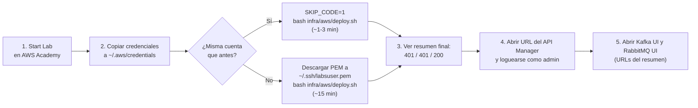

# 📌 Estado y contexto del proyecto — leer al iniciar sesión

> Objetivo: abrir este archivo y en 5 minutos saber **qué hay**, **dónde está** y **cómo
> dejarlo funcionando** para la presentación.

---

## 1. ¿Qué es Pedidos360 y en qué estado está?

Sistema de pedidos Cloud Native (Angular + 8 microservicios Spring Boot + RabbitMQ + Kafka +
IDaaS). Cumple las rúbricas **EP5** (código Kafka) y **EP6** (presentación + demo en la nube).

| Ámbito | Estado |
|--------|--------|
| Código EP5 (Kafka) | ✅ Completo, 38 tests pasando en los 8 servicios |
| Despliegue en AWS | ✅ Automatizado con `infra/aws/deploy.sh` y validado de punta a punta |
| Frontend en la nube | ✅ Login con Cognito vía Hosted UI; config OIDC en tiempo de ejecución |
| PR a `develop` | ⏳ Pendiente (abrir en GitHub o `gh auth login`) |
| Login en navegador | ⏳ Probarlo una vez antes de presentar |

Ramas: `main` ← `develop` ← `feature/ep5-rubrica-100` (rama de trabajo actual).

---

## 2. Checklist del día de la presentación (paso a paso)



1. **AWS Academy → Learner Lab → Start Lab** (esperar el punto verde).
2. **AWS Details → AWS CLI → Show** → copiar el bloque completo en
   `C:\Users\Victor Barrera\.aws\credentials` (reemplazando el anterior).
3. Si es **otra cuenta/taller**: **Download PEM** → guardarlo como
   `C:\Users\Victor Barrera\.ssh\labsuser.pem`.
4. En **Git Bash**, desde `C:\Duoc\Cloud-Native`:
   ```bash
   SKIP_CODE=1 bash infra/aws/deploy.sh   # misma cuenta
   bash infra/aws/deploy.sh               # cuenta nueva (o si cambiaste código)
   ```
5. Al final el script imprime la URL de la app, Kafka UI, RabbitMQ UI y usuarios. Ensayar el
   guion de `docs/DESPLIEGUE_AWS.md` → "Guion de demo".

> ⏰ El lab dura ~4 h. Al cerrarlo las EC2 se apagan, pero **nada se borra**: la próxima vez
> basta con el paso 4 con `SKIP_CODE=1`.

---

## 3. ¿Qué hace `deploy.sh` exactamente?

| Paso | Qué crea / verifica | Cómo lo reconoce si ya existe |
|------|---------------------|-------------------------------|
| 1 | Credenciales, llave SSH, tu IP pública | — |
| 2 | Security group `pedidos360-sg` + reglas (tu IP para SSH/UIs) | Por nombre |
| 3 | 2 EC2 `t3.large` (Docker instalado vía user-data) + 2 IPs elásticas | Por tag `Name` |
| 4 | API Gateway HTTP `pedidos360-api-manager` | Por nombre |
| 5 | Cognito: pool `pedidos360-tenant`, dominio, client `pedidos360-spa`, grupos y usuarios | Por nombre |
| 6 | Authorizer JWT `cognito-jwt`, 3 integraciones, 3 rutas, stage `$default` | Por nombre / route key |
| 7 | Espera a que Docker esté instalado en las EC2 | Archivo `/var/tmp/bootstrap-done` |
| 8 | Sube el código, genera `.env` (reutiliza claves), `docker compose up --build` | `SKIP_CODE=1` lo omite |
| 9 | Prueba: frontend 200, `config.json`, API sin token 401, token falso 401, token real 200 | — |

---

## 4. Problemas frecuentes

| Síntoma | Causa | Solución |
|---------|-------|----------|
| `Credenciales AWS inválidas o vencidas` | Pasaron ~4 h o lab detenido | Start Lab y volver a copiar credenciales |
| SSH / Kafka UI no abre | Cambió tu IP pública | Re-ejecutar `deploy.sh` (agrega tu IP nueva al SG) |
| `/api/...` devuelve 500 justo tras arrancar | Servicios aún iniciando | Esperar 1-2 min y reintentar |
| `/api/...` 401 con sesión iniciada | Token expirado (60 min) | Cerrar sesión y volver a entrar |
| Login redirige a error `redirect_mismatch` | Callback no registrado | Re-ejecutar `deploy.sh` (actualiza callbacks del client) |
| Contenedor caído | Falta de memoria / arranque | `ssh ... 'cd ~/pedidos360/infra/aws && docker compose -f docker-compose.apps.yml up -d'` |
| `t3.xlarge not authorized` | Límite del Learner Lab | Usar `t3.large` (default del script) |

Ver logs de un servicio:
```bash
ssh -i "$HOME/.ssh/labsuser.pem" ec2-user@<IP apps> \
  'cd ~/pedidos360/infra/aws && docker compose -f docker-compose.apps.yml logs --tail 50 analytics-service'
```

---

## 5. Mapa de la documentación

| Archivo | Para qué |
|---------|----------|
| `README.md` | Visión general, arquitectura local y en la nube |
| `docs/GUIA_DE_ESTUDIO_EP6.md` | **Estudiar para la presentación** (didáctica, con diagramas) |
| `docs/DESPLIEGUE_AWS.md` | Recursos AWS, guion de demo, pruebas con curl |
| `docs/ARQUITECTURA_KAFKA.md` | Detalle técnico de Kafka (tolerancia a fallos, paralelismo) |
| `docs/GUIA_DE_ESTUDIO_EP5.md` | Guía desde cero de la EP5 (Kafka + RabbitMQ) |
| `CLAUDE.md` | Contexto resumido que Claude Code carga automáticamente |
