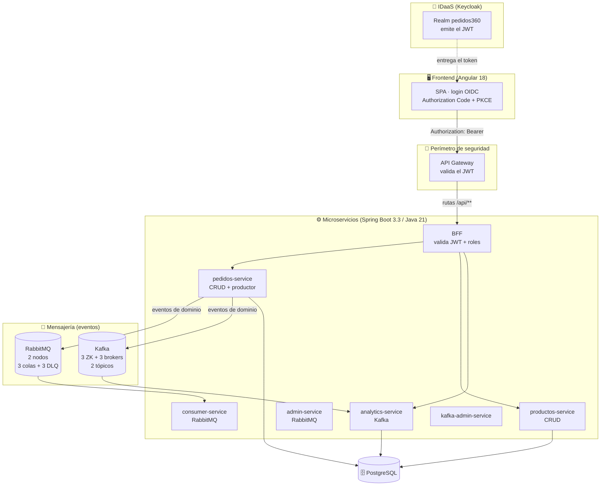
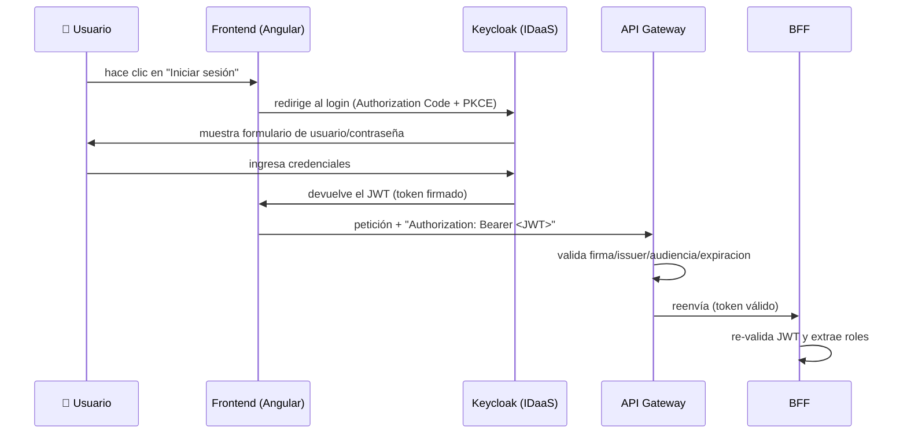
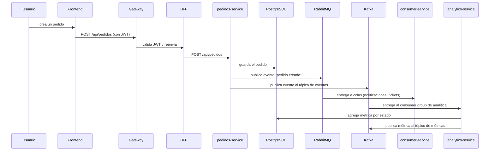

# 🎓 Guía de Estudio — Arquitectura Cloud Native de Pedidos360 (desde cero)

> Pensada para alguien que **no sabe nada** del tema. Cada concepto se explica con una
> analogía de la vida real y un diagrama. Al final hay preguntas de autoevaluación.

---

## 📑 Índice

1. [El problema que resolvemos](#1-el-problema-que-resolvemos)
2. [Conceptos base (lo mínimo indispensable)](#2-conceptos-base-lo-mínimo-indispensable)
3. [La arquitectura completa de Pedidos360](#3-la-arquitectura-completa-de-pedidos360)
4. [Cada pieza con una analogía](#4-cada-pieza-con-una-analogía)
5. [Seguridad: ¿cómo sabes quién es quién? (JWT)](#5-seguridad-cómo-sabes-quién-es-quién-jwt)
6. [RabbitMQ en detalle](#6-rabbitmq-en-detalle)
7. [Kafka en detalle](#7-kafka-en-detalle)
8. [Flujos completos paso a paso](#8-flujos-completos-paso-a-paso)
9. [Tolerancia a fallos, paralelismo y distribución](#9-tolerancia-a-fallos-paralelismo-y-distribución)
10. [Glosario completo](#10-glosario-completo)
11. [Preguntas de autoevaluación](#11-preguntas-de-autoevaluación)
12. [Cómo probarlo con tus propias manos](#12-cómo-probarlo-con-tus-propias-manos)

---

## 1. El problema que resolvemos

**Pedidos360** es un sistema de gestión de pedidos: los clientes crean pedidos, los operadores
cambian su estado (pendiente → confirmado → enviado → entregado), y queremos además **analizar
en tiempo real** cuántos pedidos hay por estado y cuánto se ha vendido.

### 1.1 Monolito vs. microservicios

Imagina un **restaurante**:

- **Monolito** 🏪 = un solo local donde la misma cocina hace todo: entradas, platos, postres
  y el delivery. Si la cocina se satura, TODO se detiene.
- **Microservicios** 🍜 = un *food court*: cada local se especializa en una cosa (sushi, pizza,
  ensaladas). Si uno se llena, los demás siguen trabajando.

```text
MONOLITO (todo junto)                  MICROSERVICIOS (separados por función)
┌──────────────────────────┐           ┌──────────┐ ┌──────────┐ ┌──────────┐
│  Interfaz + Lógica +     │           │ Pedidos  │ │Productos │ │ Analítica│
│  Base de datos (todo 1)  │           └────┬─────┘ └────┬─────┘ └────┬─────┘
└──────────────────────────┘                │            │            │
                                            └──────┬─────┴─────┬──────┘
                                        se comunican por API y por eventos
```

**Ventajas de los microservicios:** cada uno se desarrolla, despliega y escala **por separado**;
si uno falla, no tumba al resto.

### 1.2 ¿Y por qué necesitamos "mensajería" (RabbitMQ y Kafka)?

Cuando creas un pedido, pasan **varias cosas a la vez**: hay que notificar al cliente, generar
un ticket, generar un documento de envío, y además alimentar la analítica. Si el servicio de
pedidos hiciera todo eso "en línea", se volvería lento y frágil (si la notificación falla,
¿se pierde el pedido?).

La solución es **desacoplar**: el servicio de pedidos solo guarda el pedido y **publica un
evento** ("¡acaba de crearse un pedido!"). Los demás servicios **escuchan** ese evento y hacen
su trabajo a su ritmo. Eso es la **arquitectura orientada a eventos**, y para eso usamos dos
herramientas complementarias:

| Herramienta | Se usa para | Analogía |
|-------------|-------------|----------|
| **RabbitMQ** | Trabajos transaccionales con garantía de entrega | Correo interno con acuse de recibo |
| **Kafka** | Streaming / analítica de alto volumen | Cinta transportadora con historial |

---

## 2. Conceptos base (lo mínimo indispensable)

### 2.1 ¿Qué es una API REST?
Una **API** es la "ventanilla" por la que una aplicación le pide cosas a otra. **REST** es un
estilo: usas las URLs y los verbos HTTP (`GET` leer, `POST` crear, `PUT/PATCH` modificar,
`DELETE` borrar). Ejemplo: `GET /api/pedidos` → "dame todos los pedidos".

### 2.2 ¿Qué es un contenedor (Docker)?
Un contenedor es una **caja aislada** que lleva tu aplicación y todo lo que necesita para
correr. Es como un *tupper* con la comida lista: lo abres en cualquier cocina (máquina) y
funciona igual. **Docker Compose** es un archivo (`docker-compose.yml`) que define **muchas
cajas a la vez** y cómo se conectan entre ellas.

### 2.3 ¿Qué es un evento / mensaje?
Un **evento** es un dato que describe algo que **ya pasó**: "pedido #123 creado", "pedido #123
entregado". Es **inmutable** (el pasado no cambia). Los sistemas se comunican publicando y
consumiendo eventos.

### 2.4 ¿Qué es "cloud native"?
Construir aplicaciones pensadas para correr en la nube: empaquetadas en contenedores, divididas
en microservicios, escalables horizontalmente (agregar más copias) y tolerantes a fallos.

---

## 3. La arquitectura completa de Pedidos360



> 💡 **Cómo leer el diagrama:** las flechas sólidas son llamadas directas; las flechas de
> puntos son "entregas" (el token). Las cajas agrupadas con un título (subgraphs) son **capas**:
> frontend arriba, perímetro, luego los microservicios, y abajo la mensajería y la base de datos.

### Los puertos (dónde vive cada cosa en local)

| Componente | Puerto | Para qué |
|-----------|--------|----------|
| Frontend | 4200 | La web que ve el usuario |
| API Gateway | 8080 | Entrada única (valida JWT) |
| BFF | 8080 interno | Fachada del frontend |
| pedidos-service | 8081 | CRUD de pedidos + publica eventos |
| productos-service | 8082 | CRUD de productos |
| consumer-service | 8083 | Consume RabbitMQ (notificaciones, tickets, documentos) |
| admin-service | 8084 | Administra RabbitMQ por REST |
| analytics-service | 8086 | Consume Kafka y agrega métricas |
| kafka-admin-service | 8087 | Administra Kafka por REST |
| Kafka UI | 8091 | Panel visual de Kafka |
| Keycloak | 8090 | Login (IDaaS) |

---

## 4. Cada pieza con una analogía

### 4.1 Frontend (Angular)
Lo que **ve y usa** el usuario (botones, tablas, formularios). Es una **SPA** (Single Page
Application): una sola página que cambia de contenido sin recargar. **No guarda secretos** ni
la lógica de negocio; solo pide datos a la API.

### 4.2 API Gateway
El **portero del edificio** 🚪. Todo el tráfico entra por él. Su trabajo:
1. Mirar tu **identificación** (el JWT).
2. Si es válida, dejarte pasar a la zona que corresponde.
3. Si no traes identificación (o está falsificada/expirada), **te rechaza** (HTTP 401/403).

### 4.3 BFF (Backend For Frontend)
Un **asistente personal** que conoce los gustos del frontend. En vez de que el frontend llame a
5 servicios distintos, le pide al BFF "dame el resumen", y el BFF se encarga de hablar con cada
microservicio. Además **re-valida el JWT** (defensa en profundidad) y aplica **roles**.

### 4.4 Microservicios
Cada uno es una **app Spring Boot independiente** con su propia responsabilidad:
- `pedidos-service` → guarda pedidos y **publica eventos**.
- `productos-service` → guarda productos.
- `consumer-service` → **escucha** RabbitMQ y hace trabajos (notificar, emitir ticket, documento).
- `analytics-service` → **escucha** Kafka y calcula métricas.
- `admin-service` / `kafka-admin-service` → exponen una API para **administrar** los brokers.

### 4.5 PostgreSQL
La **base de datos relacional**: tablas con filas y columnas. Guarda el estado de negocio
(pedidos, productos, métricas). En los microservicios se accede con **Spring Data JPA**
(entidades + repositorios).

### 4.6 RabbitMQ
El **correo interno con acuse de recibo** 📬. Un servicio deja un mensaje en un **buzón** (cola)
y otro lo recoge **cuando puede**, y **confirma** que lo procesó (ACK). Si no puede procesarlo,
el mensaje va a una **cola de muertos** (DLQ) para no perderlo.

### 4.7 Kafka
La **cinta transportadora con historial** 🎢. Los eventos pasan en orden y **quedan grabados**
un tiempo (retención). Varios consumidores pueden leerlos a su ritmo, cada uno con su
"marcapáginas" (offset). Ideal para **analítica** y alto volumen.

### 4.8 Keycloak (IDaaS)
El **organismo que emite identificaciones oficiales** 🪪 (IDaaS = Identity as a Service). Tú te
autenticas una vez y Keycloak te entrega un **JWT** firmado que luego presentas en cada puerta.

---

## 5. Seguridad: ¿cómo sabes quién es quién? (JWT)

### 5.1 El flujo de login (OAuth 2.0 / OpenID Connect + PKCE)



### 5.2 ¿Qué es un JWT por dentro?

Un JWT es una **credencial de concierto** 🎟️: tiene tu nombre, tu zona (roles), y está **firmada
por el organizador** (no puedes falsificarla), con fecha de vencimiento.

```text
JWT = header . payload . firma

eyJhbGciOiJSUzI1NiJ9  .  eyJzdWIiOiJ1c3VhcmlvIiwgInJvbGVzIjpbIkFETUlOIl19  .  SflKxwRJSMeKKF2QT4fwpMeJf36POk6yJV_adQssw5c

┌─────────┐  ┌──────────────────────────────────────────┐  ┌──────────────────────┐
│ Header  │  │ Payload (tus datos)                      │  │ Firma (sello)        │
│ algoritmo│  │ - sub: usuario                           │  │ generada con la clave│
│ de firma │  │ - realm_access.roles: [ADMIN, OPERADOR] │  │ privada del IDaaS    │
│          │  │ - exp: fecha de vencimiento             │  │ (imposible de        │
│          │  │ - aud: pedidos360-spa                   │  │ falsificar)          │
└─────────┘  └──────────────────────────────────────────┘  └──────────────────────┘
```

**Dónde se valida:**
1. **API Gateway** — primera barrera (rechaza tokens ausentes/inválidos/expirados).
2. **BFF** — segunda barrera (defensa en profundidad) y control fino por **rol**.

Los microservicios *downstream* (pedidos, productos, analytics) **no validan JWT**: confían en
que solo reciben tráfico del BFF (red interna). En producción irían detrás del API Manager.

---

## 6. RabbitMQ en detalle

### 6.1 Los 3 conceptos clave

```text
PRODUCTOR ──► EXCHANGE ──► COLA ──► CONSUMIDOR
   publica      enruta      almacena    procesa
```

- **Productor**: el que publica el mensaje (aquí, `pedidos-service`).
- **Exchange**: el "repartidor de correo": decide a qué cola(s) va cada mensaje.
- **Cola (queue)**: el buzón donde esperan los mensajes.
- **Consumidor**: el que recoge y procesa (aquí, `consumer-service`).

### 6.2 Tipos de exchange (cómo se reparte)

```text
EXCHANGE "topic" (pedidos360.topic) — enruta por PATRÓN con comodines
────────────────────────────────────────────────────────────────────
routing key: "pedido.creado"
      ├──► Cola notificaciones   (patrón "pedido.#")        ✓  (el # coincide con todo)
      ├──► Cola documentos       (patrón "pedido.estado.entregado")  ✗  (no coincide)
      └──► Cola tickets          (no está aquí, está en "direct")

EXCHANGE "direct" (pedidos360.direct) — enruta por IGUALDAD EXACTA
────────────────────────────────────────────────────────────────────
routing key: "pedido.creado"
      └──► Cola tickets          (binding exacto "pedido.creado")  ✓
```

> 💡 `topic` usa comodines (`*` = una palabra, `#` = varias). `direct` compara el routing key
> de forma exacta. En Pedidos360 usamos **ambos** (lo exige la rúbrica).

### 6.3 Dead Letter Queue (DLQ) — el "cementerio" de mensajes

Si un consumidor **no puede** procesar un mensaje (por ejemplo, viene vacío), no queremos
perderlo ni reintentarlo infinitamente. Entonces:

```text
                    procesa OK  ──► basicAck (confirmado, se elimina)
                   /
Cola de negocio ──► consumidor
                   \
                    falla irreparable ──► basicNack(requeue=false) ──► DLQ
                    falla transitoria ──► basicNack(requeue=true) ──► reintenta
```

- **ACK** = "listo, lo procesé" (el mensaje se elimina de la cola).
- **NACK (requeue=false)** = "esto nunca va a funcionar" → va a la **DLQ**.
- **NACK (requeue=true)** = "falló por algo temporal" → vuelve a la cola y se **reintenta**.

Pedidos360 tiene **3 colas + 3 DLQ**:

| Cola de negocio | DLQ asociada |
|-----------------|--------------|
| `pedidos360.notificaciones.queue` | `pedidos360.notificaciones.dlq` |
| `pedidos360.tickets.queue` | `pedidos360.tickets.dlq` |
| `pedidos360.documentos.queue` | `pedidos360.documentos.dlq` |

### 6.4 El clúster de 2 nodos (alta disponibilidad)

```text
          ┌──────────────┐     ┌──────────────┐
          │  rabbitmq1   │◄────┤  rabbitmq2   │
          │  (nodo 1)    │     │  (nodo 2)    │
          └──────┬───────┘     └──────┬───────┘
                 │  comparten la misma  │
                 │  cookie Erlang       │
                 └────── (clúster) ─────┘
```

Dos nodos que comparten la misma **cookie Erlang** forman un **clúster**: si uno cae, el otro
sigue sirviendo. Se verifican con `rabbitmq-diagnostics cluster_status` (debe mostrar 2 nodos).

---

## 7. Kafka en detalle

### 7.1 Topic, partición, réplica y offset

```text
TÓPICO = pedidos360.pedidos.eventos  (un "canal" con nombre)

┌─ Partición 0 ──► [msg0][msg1][msg2][msg3]...
├─ Partición 1 ──► [msg0][msg1][msg2]...
└─ Partición 2 ──► [msg0][msg1][msg2][msg3][msg4]...

offset = la posición de cada mensaje DENTRO de su partición (empieza en 0)
```

- **Topic**: canal con nombre donde se publican mensajes.
- **Partición**: subdivisión de un topic. Permite **paralelismo** (cada partición la lee un
  consumidor a la vez).
- **Offset**: número de posición del mensaje dentro de su partición. Cada partición empieza en 0.
- **Key**: decide a qué partición va un mensaje (`hash(key) % nº particiones`). Misma key →
  misma partición → **orden garantizado** para esa key.
- **Réplica**: copia de una partición en otro broker (para no perder datos si un broker cae).

### 7.2 Réplicas y líderes (tolerancia a fallos)

Cada partición tiene un **líder** (el que recibe lecturas/escrituras) y **réplicas** (copias de
seguridad). Pedidos360 usa **3 particiones y factor de replicación 3**:

```text
Tópico con 3 particiones y 3 réplicas, repartidas entre 3 brokers

      Broker 1          Broker 2          Broker 3
    ┌────────────┐    ┌────────────┐    ┌────────────┐
    │ P0 (líder) │    │ P0 (copia) │    │ P0 (copia) │
    │ P1 (copia) │    │ P1 (líder) │    │ P1 (copia) │
    │ P2 (copia) │    │ P2 (copia) │    │ P2 (líder) │
    └────────────┘    └────────────┘    └────────────┘

Si el Broker 1 se cae:
  → P0 se re-elige con líder en el Broker 2 o 3 (que ya tenían la copia).
  → No se pierde ningún mensaje.
```

### 7.3 Consumer groups (balanceo de carga)

```text
Tópico (3 particiones)              Consumer group
  P0 ──────────┐                   ┌──────────────────────┐
  P1 ──────────┼──────────────────►│  Consumidor A (lee P0)│
  P2 ──────────┘                   │  Consumidor B (lee P1)│
                                   │  Consumidor C (lee P2)│
                                   └──────────────────────┘

Regla: cada partición la lee UN SOLO consumidor del grupo.
→ 3 particiones = hasta 3 consumidores trabajando en paralelo.
→ Si un consumidor muere, Kafka reasigna su partición a otro (resiliencia).
```

Pedidos360 usa **2 consumer groups** (distribución de responsabilidades):
- `pedidos360-analytics-group` → consume `pedidos360.pedidos.eventos` y agrega métricas.
- `pedidos360-reporting-group` → consume `pedidos360.analitica.metricas` (reportes/BI).

### 7.4 Zookeeper (el "directorio" del clúster)

Kafka (en esta versión) usa **Zookeeper** para coordinar: elegir líderes, guardar metadatos.
Pedidos360 usa **3 Zookeeper** en **quorum** (mayoría): con 3 nodos, tolera la caída de 1.

### 7.5 Configuraciones de administración

| Parámetro | Qué hace | Valor en Pedidos360 |
|-----------|----------|---------------------|
| `retention.ms` | Cuánto tiempo se guardan los mensajes | 7 días (eventos) / 30 días (métricas) |
| `cleanup.policy` | `delete` (borra por tiempo) o `compact` (conserva el último valor por clave) | `delete` y `compact` |
| `replication.factor` | Cuántas copias de cada partición | 3 |
| `min.insync.replicas` | Mínimas réplicas sincronizadas para confirmar escritura | 2 |

---

## 8. Flujos completos paso a paso

### 8.1 Crear un pedido (el flujo más importante)



### 8.2 Analítica en tiempo real (doble tópico)

```text
pedidos-service                    analytics-service
      │                                   │
      │  publica PedidoEvent              │
      └──► tópico "pedidos360.pedidos.eventos" ──► consumer group "analytics"
                                              │
                                              │ agrega por estado (PostgreSQL)
                                              │ y publica MetricasPedidoDto
                                              ▼
                              tópico "pedidos360.analitica.metricas"
                                              │
                                              └──► consumer group "reporting" (BI)
```

**La magia:** un pedido entra por el primer tópico, se convierte en una **métrica** y sale por
el segundo tópico, sin que el usuario tenga que esperar nada (es **asíncrono**).

---

## 9. Tolerancia a fallos, paralelismo y distribución

Estos son los **tres conceptos estrella** que te van a preguntar:

### 9.1 Tolerancia a fallos (que nada se rompa si algo cae)
- **Kafka:** 3 brokers + réplicas (RF=3, ISR=2). Si cae 1 broker, se re-elige líder sin perder datos.
- **Zookeeper:** 3 nodos en quorum (toleran 1 caído).
- **RabbitMQ:** 2 nodos en clúster + DLQ (los mensajes fallidos no se pierden).
- **Productores:** `acks=all` (confirmar en todas las réplicas) + **idempotencia** (sin duplicados).
- **Consumidores:** reintentos + **Dead Letter** (los mensajes defectuosos no tumban el flujo).

### 9.2 Paralelismo (hacer varias cosas a la vez)
- **3 particiones** permiten hasta **3 consumidores concurrentes** (un hilo por partición).
- El **particionado por clave** mantiene el orden donde importa (misma key → misma partición).

### 9.3 Procesamiento distribuido (repartir el trabajo)
- **Consumer groups** con offsets independientes: cada grupo lee los mismos mensajes sin pisarse.
- Al caer un miembro del grupo, Kafka **reasigna** sus particiones a otro (balanceo automático).

---

## 10. Glosario completo

| Término | Definición corta |
|---------|------------------|
| **Microservicio** | App pequeña y autónoma con una sola responsabilidad. |
| **API REST** | Ventanilla HTTP para pedir/dar datos (GET/POST/PUT/DELETE). |
| **Contenedor (Docker)** | Caja aislada con la app y sus dependencias. |
| **Docker Compose** | Archivo que define varios contenedores y su red. |
| **Evento** | Dato inmutable que describe algo que ya pasó. |
| **JWT** | Token firmado con tus datos (usuario, roles, expiración). |
| **IDaaS** | Servicio de identidad (Keycloak, Azure AD, Okta). |
| **API Gateway** | Entrada única que valida el JWT y enruta. |
| **BFF** | Fachada del frontend; agrega llamadas a microservicios. |
| **Exchange** (RabbitMQ) | Repartidor: decide a qué cola va cada mensaje. |
| **Routing key** | Etiqueta del mensaje que usa el exchange para enrutar. |
| **Cola** | Buzón donde esperan los mensajes. |
| **DLQ** | Cola de mensajes "muertos" (que no se pudieron procesar). |
| **ACK / NACK** | Confirmación manual: procesado / reintento / desvío a DLQ. |
| **Topic** (Kafka) | Canal con nombre donde se publican mensajes. |
| **Partición** | Subdivisión de un topic (permite paralelismo). |
| **Offset** | Posición del mensaje dentro de su partición. |
| **Réplica** | Copia de una partición en otro broker. |
| **ISR** | Réplicas sincronizadas con el líder. |
| **Consumer group** | Grupo que comparte el trabajo y recuerda su offset. |
| **Key** | Decide la partición (`hash(key) % particiones`). |
| **retention.ms** | Tiempo que se conservan los mensajes. |
| **cleanup.policy** | `delete` (por tiempo) o `compact` (último valor por clave). |
| **Zookeeper** | Coordinador del clúster Kafka (elección de líder, metadatos). |
| **Quorum** | Mayoría de nodos necesaria para operar. |

---

## 11. Preguntas de autoevaluación

Responde antes de mirar las respuestas. 👇

1. **¿Por qué usamos RabbitMQ y Kafka a la vez, en vez de solo uno?**
2. **¿Qué pasa si el broker líder de una partición de Kafka se cae?**
3. **¿Qué es una Dead Letter Queue y para qué sirve?**
4. **¿Por qué 3 particiones permiten procesar en paralelo, pero una sola no?**
5. **¿Qué valida el API Gateway y qué valida el BFF?**
6. **¿Qué es un consumer group y cómo logra "balanceo de carga"?**
7. **¿Qué diferencia hay entre `cleanup.policy=delete` y `cleanup.policy=compact`?**
8. **¿Qué garantiza `acks=all` + idempotencia en un productor Kafka?**
9. **¿Qué es un JWT y por qué no se puede falsificar?**
10. **¿Qué es el "sticky partitioner" y qué implica para los mensajes sin key?**

<details>
<summary><b>Ver respuestas</b></summary>

1. RabbitMQ para trabajos **transaccionales con garantía de entrega** (ACK + DLQ, tipo
   notificar/emitir ticket); Kafka para **streaming/analítica de alto volumen** con historial
   (retención) y múltiples consumidores independientes.
2. Se **re-elige un líder** entre las réplicas ISR (copias) y el sistema sigue funcionando **sin
   perder mensajes** (gracias al factor de replicación 3).
3. Una cola que recibe los mensajes **que no se pudieron procesar** tras reintentos, para
   inspeccionarlos después sin perderlos ni bloquear la cola principal.
4. Porque **cada partición la lee un solo consumidor del grupo**: con 3 particiones puedes tener
   3 consumidores trabajando a la vez; con 1 partición, solo 1.
5. El **Gateway** valida firma/issuer/audiencia/expiración (rechaza 401/403). El **BFF** re-valida
   (defensa en profundidad) y además aplica **autorización por rol**.
6. Un conjunto de consumidores que **comparten** la lectura de un tópico y recuerdan su offset.
   Kafka reparte las particiones entre los miembros; si uno cae, reasigna sus particiones.
7. `delete` borra mensajes cuando cumplen `retention.ms`; `compact` conserva **el último valor
   por clave** (ideal para métricas por estado).
8. `acks=all` confirma solo cuando **todas las réplicas ISR** recibieron el mensaje; la
   idempotencia evita **duplicados** ante reintentos. Juntas = entrega fiable sin pérdida ni
   duplicados.
9. Un token con datos (usuario, roles) **firmado criptográficamente** por el IDaaS: si alteras
   un solo carácter, la firma deja de cuadrar y el token se rechaza.
10. Kafka 2.4+ agrupa mensajes sin key en **batches** en una misma partición por eficiencia
    (no rota uno a uno). Por eso "sin key no hay garantía de partición ni de orden"; con key,
    siempre va a la misma partición.
</details>

---

## 12. Cómo probarlo con tus propias manos

```bash
# 1. Levantar todo (PostgreSQL + RabbitMQ 2 nodos + Kafka 3 ZK/3 brokers + servicios)
cd infra/apps
cp .env.example .env
docker compose up --build

# 2. Ver el clúster RabbitMQ (2 nodos)
docker exec infra-apps-rabbitmq1-1 rabbitmq-diagnostics cluster_status

# 3. Ver los tópicos de Kafka (2 tópicos, 3 particiones, 3 réplicas)
docker exec infra-apps-kafka1-1 kafka-topics --bootstrap-server localhost:29092 --describe

# 4. Crear un pedido (con login en http://localhost:4200) y ver la analítica
#    GET http://localhost:8080/api/analitica/resumen  (vía Gateway + BFF)

# 5. Paneles
#    RabbitMQ: http://localhost:15672   ·  Kafka: http://localhost:8091
```

> 📌 **Orden de la demo:** primero crea un pedido; *recién después* aparecerán los consumer
> groups en Kafka (se crean al procesar el primer mensaje).

---

*Guía generada para el estudio y la defensa de la arquitectura. Los diagramas Mermaid se ven
como imágenes en GitHub y en la vista previa de VS Code.*
